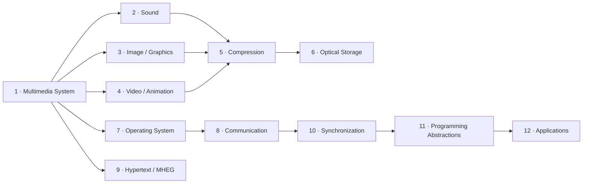

# Course Map

The syllabus gives hours per unit, not weeks. The 45 theory hours equal 15 weeks at 3 hours a week, so the weeks below are a straight-line allocation. Treat them as approximate; your lecturer's calendar may differ. Tutorial (1 hr) and practical (2 hrs) are on top of this.

| Unit | Topic | Hours | Approx. weeks | Status on this site |
|---|---|---|---|---|
| [1](unit-01/index.md) | Multimedia System | 3 | 1 | Ready |
| [2](unit-02/index.md) | Sound and Audio | 4 | 2–3 | **Ready** |
| [3](unit-03/index.md) | Image and Graphics | 4 | 3–4 | **Ready** |
| [4](unit-04/index.md) | Video and Animation | 4 | 4–5 | **Ready** |
| [5](unit-05/index.md) | Data Compression | 6 | 6–7 | **Ready** |
| [6](unit-06/index.md) | Optical Storage Media | 4 | 8–9 | **Ready** |
| [7](unit-07/index.md) | Multimedia Operating System | 4 | 9–10 | **Ready** |
| [8](unit-08/index.md) | Multimedia Communication System | 4 | 10–11 | **Ready** |
| [9](unit-09/index.md) | Documents, Hypertext and MHEG | 4 | 12–13 | **Ready** |
| [10](unit-10/index.md) | Synchronization | 4 | 13–14 | **Ready** |
| [11](unit-11/index.md) | Abstraction of Programming | 2 | 14–15 | **Ready** |
| [12](unit-12/index.md) | Multimedia Application | 2 | 15 | **Ready** |

## How the units connect

Units 2 to 4 describe the **media** themselves. Unit 5 shrinks them so they fit on disk (Unit 6) and across networks (Unit 8). Units 7, 8 and 10 explain how an operating system and a network keep **continuous** media flowing on time. Units 11 and 12 show how developers put it all together.

## Which lecturer files each unit follows

| Unit | Lecturer files |
|---|---|
| 1 | *Unit 1 – Introduction*, *mul c1* |
| 2 | *Unit 2 – Sound & Audio System* |
| 3 | *Unit 3 – Image and Graphics*, *mul c3* |
| 4 | *Unit 4 – Video and Animation*, *mul c4* |
| 5 | *Unit 5 – Data Compression*, *Huffman Coding* |
| 6 | *Unit 6 – cd*, *Unit 6 – optical-storage-media* |
| 7, 8, 9 | **No lecturer notes.** Written from the syllabus and standard textbook knowledge, with a banner on every page. |
| 10 | *Unit 10 – Synchronization*, *Unit 10 – Synchronization Presentation* |
| 11 | *Unit 11 – Abstractions for Programming* |
| 12 | *Unit 12 – Multimedia Application* |
