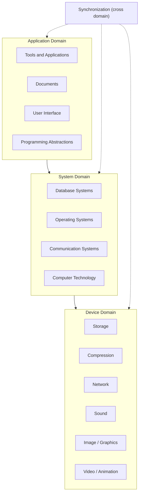

# Global Structure of Multimedia

!!! exam "Exam tip"
    This is the one diagram you are most likely to be asked to **draw and explain**. Practise redrawing it from memory until you can place every box.

## The big picture

The **global structure of multimedia** is a framework that covers the **devices, systems, applications and interactions** needed to **capture, process, store, transmit and present** media in a cohesive and interactive way.

It has **three domains** and one **cross-domain** layer:

1. **Application domain** (top)
2. **System domain** (middle)
3. **Device domain** (bottom)
4. **Synchronization**, a vertical layer that runs through all three

In the figure the three domains are stacked as boxes, with a **tall vertical bar labelled Synchronization** along the left side that spans all three.

| Layer | Boxes in the figure |
|---|---|
| **Application domain** | *Tools and Applications* (full-width bar); below it *Documents*, *User Interface*, *Programming Abstractions* |
| **System domain** | *Database Systems*, *Operating Systems*, *Communication Systems*; below them a full-width bar, *Computer Technology* |
| **Device domain** | *Storage*, *Compression* and *Network*; under Compression: *Sound*, *Image/Graphics*, *Video/Animation* |

## Application domain

Provides the functions the user needs to **develop and present multimedia projects**. It includes **software tools** and a project-development methodology. The services of the system domain are offered to it through **programming abstractions**.

**End-user software:** media players, video editors, animation tools, presentation software.

- **Documents.** Multimedia-enhanced documents that combine text, images, audio and video: e-learning materials, interactive PDFs, web pages. Document handling means generating the different media and recording them at presentation time.
- **User interface.** Lets people interact with the system: buttons, menus, touch interfaces. It must be **intuitive, responsive and multimedia-friendly**.
- **Programming abstractions.** APIs, libraries and frameworks (media APIs, graphics libraries, game engines) that spare developers low-level complexity.

## System domain

Includes **all the support for using the functions of the device domain**: operating systems, communication systems (networking) and database systems. *Computer technology* is the layer that connects the device domain to the system domain.

- **Database systems.** Store and manage multimedia objects (audio, video, images) with support for **searching, indexing and retrieval**. Example: multimedia databases for video libraries and digital archives. They also allow structured access to large databases.
- **Operating systems.** Manage the resources multimedia needs: **CPU, memory, disk and I/O devices**. They provide **real-time scheduling** and **device drivers** (sound card, graphics card). Examples: Windows, Linux, macOS.
- **Communication systems.** Handle data exchange between systems with **protocols and data synchronization**. Examples: **TCP/IP** and **RTP** (for real-time media). They are responsible for data transmission.

## Device domain

Covers the basic concepts and skills for processing the media elements and handling **physical devices**: cameras, microphones, speakers and other input/output hardware. It includes the processing of digital signals, image, graphics, animation, audio and video.

- **Compression.** Raw multimedia data is very large. Compression reduces its size for **faster transmission** and **efficient storage**. Examples: **MP3, AAC** (audio), **JPEG, PNG** (image), **MPEG, H.264** (video). It is essential for streaming, video conferencing and multimedia applications.
- **Network.** Carries multimedia data between systems for streaming, online video calls and distributed applications. It requires **high bandwidth and low latency**.
- **Storage.** Holds content permanently or temporarily: hard disks, SSDs, cloud storage. It must support **large data volumes and fast read/write**.

## The synchronization layer (cross domain)

A **vertical layer that affects all levels of the system**. Synchronization is the **coordination of multiple media types in time**.

- Audio must match video during playback.
- Subtitles must appear at the correct moments.
- It is critical for **video conferencing, movies and e-learning**.
- Poor synchronization causes **audio-video mismatch** and a poor user experience.

Some sources call this layer the **cross domain**: it handles the temporal relationships among media across all domains. Unit 10 is devoted to it.

!!! info "Extra"
    The small numbers printed inside the boxes of the usual textbook figure (3 to 17) are labels from the original textbook figure. They are not explained, so ignore them in the exam.

## Where students go wrong

!!! exam "Network appears twice"
    **Network** (the physical carrier, needing bandwidth and low latency) is in the **device domain**. **Communication systems** (protocols such as TCP/IP and RTP) are in the **system domain**. Do not put compression, storage or network in the system domain.

## Checkpoint

??? question "Name the three domains from top to bottom and one component of each."
    **Application** (e.g. user interface), **System** (e.g. operating systems), **Device** (e.g. compression). The vertical **synchronization** layer runs across all of them.

??? question "Why does synchronization sit across all domains rather than in one?"
    Because timing between media must be preserved at every level: when devices capture and play, when the OS schedules, when the network delivers and when the application presents. A mismatch at any level breaks the experience (for example, lips out of sync with audio).

??? question "In which domain does the operating system belong, and what two services does it give multimedia?"
    The **system domain**. It provides **real-time scheduling** and **device drivers** (for example for the sound or graphics card), while managing CPU, memory, disk and I/O.
