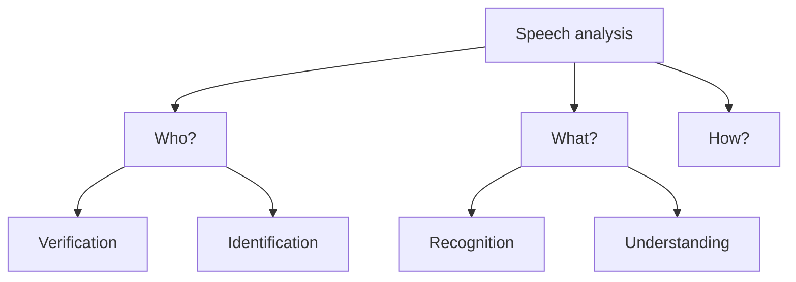
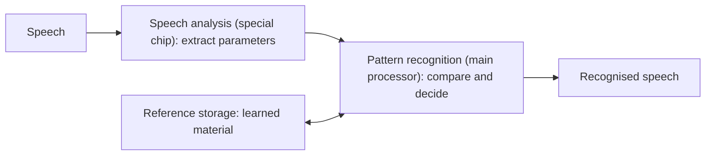

# Speech Analysis

**Speech analysis** (speech input) asks three questions about a spoken signal. It is often drawn as a tree: *Speech analysis* splits into **Who?** (*verification* and *identification*), **What?** (*recognition* and *understanding*) and **How?**.

## Who is speaking?

Human speech has characteristics that are **determined by the speaker**. Speech analysis can therefore recognise a speaker for **identification and verification**.

- The computer identifies and verifies the speaker using an **acoustic fingerprint**.
- An **acoustic fingerprint** is a **digitally stored speech probe** of a person (for example, a certain statement).

## What has been said?

This task analyses **what was said**: to **recognise and understand** the speech signal itself. A corresponding **text** is generated from the speech sequence. Applications:

- A **speech-controlled typewriter**
- A **translation system**
- Part of a **workplace for the handicapped**

## How was it said?

This area researches the **speech pattern** of a statement: *how* a certain sentence was said. A spoken sentence sounds different if a person is **angry** or **calm**.

| Question | Task | Example |
|---|---|---|
| **Who?** | **Identification and verification** of the speaker, using an acoustic fingerprint | Voice-based access |
| **What?** | **Recognition and understanding** of the content | Speech-controlled typewriter, translation |
| **How?** | The **manner** of speaking (patterns in the voice) | Angry versus calm |

## Speech recognition

**Speech recognition** is the process of **converting an acoustic signal**, captured by a **microphone or a telephone**, **to a set of words** (that is, spoken language to written text or a similar form). It is the **foundation of human-computer interaction using speech**.

Recognition systems differ along four contexts:

| Context | Options |
|---|---|
| The speaker | **Speaker-dependent** or **speaker-independent** |
| The speech | **Discrete words** or **continuous speech** |
| The vocabulary | **Small** or **large** |
| The environment | **Quiet** or **noisy** |

### The recognition principle (Figure 3-13)

The principle is **"extract characteristics to reduce data."** A typical diagram shows:

1. **Speech analysis** (on a special chip): parameters, response and **property extraction** from the speech signal.
2. **Pattern recognition** (on the main processor): **comparison with reference** material and a **decision**.
3. **Reference storage**: the **properties of the learned material**, consulted during comparison.

The output is the **recognised speech**.

### The recognition steps (Figure 3-14)

Applying the principle gives three analysis stages, each using a **knowledge source**:

| Stage | Knowledge used |
|---|---|
| **Acoustic and phonetic analysis** | **Sound patterns and word models** |
| **Syntactical analysis** | **Syntax** |
| **Semantic analysis** | **Semantics** |

The output of the last stage is **understood speech**. In the usual diagram each stage can feed back to the previous one.

!!! exam "Exam tip"
    "Explain speech recognition" is a likely long question. Give the **definition**, the **four contexts**, and the **three-stage diagram** (acoustic/phonetic → syntactical → semantic), each labelled with its knowledge source.

## Checkpoint

??? question "What is an acoustic fingerprint?"
    A **digitally stored speech probe** of a person (for example a certain statement), used to **identify or verify** who is speaking.

??? question "State the three questions of speech analysis."
    **Who** is speaking (identification and verification), **what** was said (recognition and understanding) and **how** it was said (for example angry or calm).

??? question "Name the three stages of recognition and the knowledge each uses."
    **Acoustic and phonetic analysis** (sound patterns, word models), **syntactical analysis** (syntax), **semantic analysis** (semantics).
