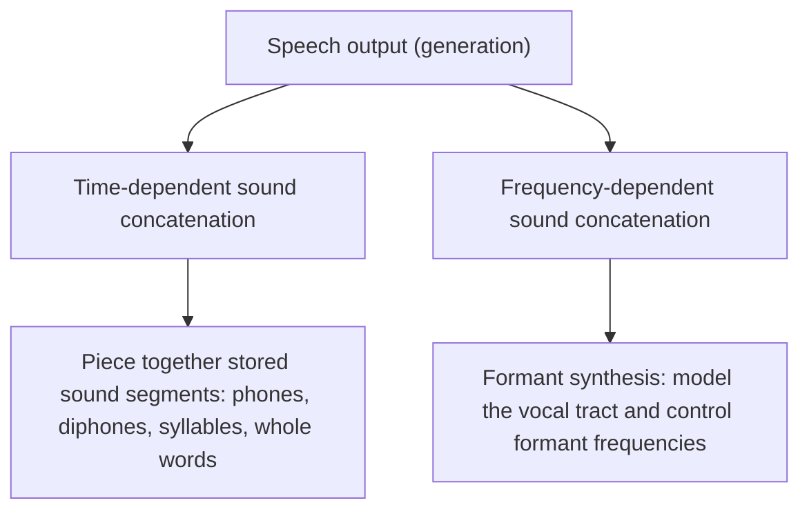
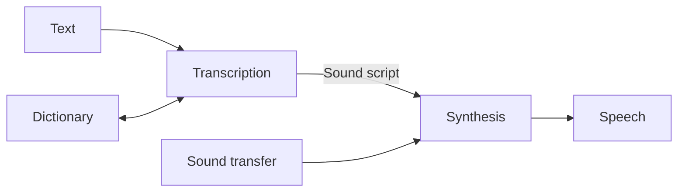

# Speech Generation

!!! source "Source"
    *Unit 2 – Sound & Audio System* pp. 27–38.

## About speech

**Speech** is the vocalised form of human communication. It can be **perceived, understood and generated** by humans and also by machines.

- A human adjusts very efficiently to different speakers and their speech habits.
- The brain can recognise the very fine line between **speech and noise**.
- The human speech signal contains a subjective lowest spectral component called the **pitch**, which is **not proportional to frequency**.

**Speech generation** is the **computer-generated simulation of human speech**. Generated speech must be **understandable** and must **sound natural**.

## Basic notions

| Term | Definition (from the notes) | Example |
|---|---|---|
| **Fundamental frequency** | The **lowest periodic spectral component** of the speech signal; present in a **voiced** sound | |
| **Phone** | The **smallest speech unit** that distinguishes one utterance or word from another in a language | The *m* of *mat* and the *b* of *bat* |
| **Allophones** | **Variants of a phone** | The aspirated *p* of *pit* and the unaspirated *p* of *spit* are allophones of the English phoneme *p* |
| **Morph** | The **smallest speech unit that carries a meaning itself** | *consider* is a morph; *reconsideration* is not |
| **Voiced sound** | Generated by the **oscillation of the vocal cords**; depends strongly on each speaker | *m*, *v*, *l* |
| **Unvoiced sound** | Generated with the **vocal cords open**; relatively independent of the speaker | *f*, *s* |

!!! exam "Exam tip"
    Know the **phone versus morph** contrast: a phone is the smallest unit of **sound**; a morph is the smallest unit of **meaning**. Know **voiced versus unvoiced** with one example each.

## Reproduced speech output: two methods

### Time-dependent sound concatenation

Pre-recorded or pre-synthesised **sound segments are pieced together** based on their timing. Individual speech units are composed like **building blocks**, and the composition can happen at different levels.

1. **Phones.** With just a few phones it is possible to create an **unlimited vocabulary**.
2. **Diphones.** Two phones form a **diphone**. The lecturer's figure builds the word *crumb* from an ordered sequence of diphones.
3. **Syllables.** To make the **transition problem** easier, syllables can be created, and speech is generated from a set of syllables (the figure shows *crumb* as one syllable sound).
4. **Whole words.** The **best pronunciation** of a word comes from storing the **whole word**. This leads to synthesis of the whole speech sequence.

**Assessment:** often used in **high-quality text-to-speech (TTS)** systems for its **naturalness**, but it needs **extensive databases** and careful management of transitions.

### Frequency-dependent sound concatenation

Speech is generated by manipulating the **frequency components** of sound, for example through **formant synthesis**.

- **Formants** are **frequency maxima in the spectrum** of the speech signal.
- Formant synthesis uses **mathematical models of the vocal tract** to generate speech sounds by controlling the **frequency and amplitude of the formants** (resonant frequencies).

**Assessment:** offers **more flexibility** and needs **less storage**, but can **struggle to sound natural**.

| | Time-dependent concatenation | Frequency-dependent concatenation |
|---|---|---|
| Idea | Join stored sound segments | Generate speech from formant models |
| Units | Phones, diphones, syllables, words | Formants (frequency maxima) |
| Strength | **Natural** sound | **Flexible**, **little storage** |
| Weakness | **Large databases**; transitions between units | Hard to make **natural-sounding** |

## Speech synthesis: the two-step process

**Speech synthesis** transforms an **existing text into an acoustic signal**. The lecturer's figure (Figure 3-11) shows the flow: *Text → Transcription (with a Dictionary) → Sound script → Synthesis (with Sound transfer) → Speech*.

**Step 1: Transcription.** The text is translated into a **sound script** using a **dictionary**. If the user notices a deficiency in the transcription, they can improve the pronunciation manually.

**Step 2: Synthesis.** The sound script is translated into a **speech signal**. Time-dependent or frequency-dependent concatenation can follow.

## Checkpoint

??? question "Differentiate a phone and a morph."
    A **phone** is the smallest unit of speech **sound** that distinguishes one word from another (the *m* of *mat*). A **morph** is the smallest unit that **carries meaning** (*consider*).

??? question "What are formants, and which generation method uses them?"
    **Formants are frequency maxima in the spectrum of the speech signal.** **Frequency-dependent sound concatenation (formant synthesis)** uses mathematical models of the vocal tract to control them.

??? question "Describe the two steps of speech synthesis."
    **Transcription:** text is converted to a sound script using a dictionary. **Synthesis:** the sound script is converted to a speech signal, using time-dependent or frequency-dependent concatenation.
