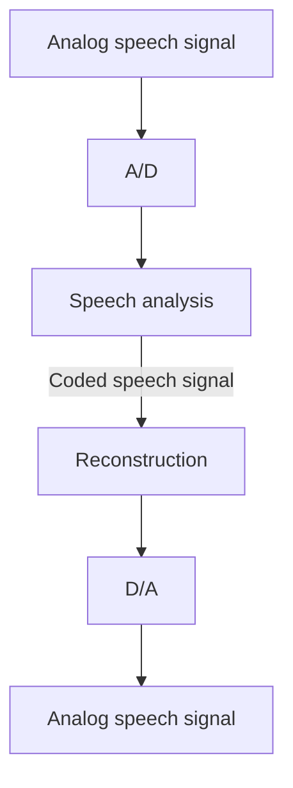

# Speech Transmission

**Speech transmission** is the field of **highly efficient encoding of speech signals** so they can be sent at a **low data rate** while keeping **noticeable quality loss to a minimum**.

There are **three principles**:

1. **Pulse Code Modulation (PCM)**
2. **Source coding**
3. **Recognition and synthesis methods**

## 1. Pulse Code Modulation (PCM)

- **Signal-form encoding** does **not consider speech-specific properties or parameters**. The techniques are simply expected to encode **audio signals** efficiently.
- A **straightforward technique for digitising an analog signal (waveform)** is **PCM**.
- PCM **prioritises the accurate representation of the audio signal over data reduction.**

!!! warning "The figure shows a different technique"
    The picture on the PCM slide is headed **Pulse Width Modulation**: the *width* of each pulse follows the amplitude of the sample. That is a different technique. In **PCM** each sample's amplitude is measured, **quantized** and written as a **binary code**, exactly the sampling and quantization process on the [Digital Audio](digital-audio.md) page. Do not draw pulse widths in a PCM answer.

## 2. Source encoding

An **alternative method**: some transformations **depend on the original signal type**. An audio signal has certain characteristics that can be **exploited in compression**.

- **Suppressing silence** in speech sequences is a typical example. It depends entirely on the **meaning (semantics) of the signal**.
- **Parametric systems** use source encoding. They use **speech-specific characteristics** to reduce data, for example the **channel vocoder**.

The figure shows the components of a transmission system using source encoding:

## 3. Recognition / synthesis method

- **Speech analysis (recognition)** takes place on the **sender side** of the transmission system.
- **Speech synthesis (generation)** takes place on the **receiver side**.
- **Only the characteristics of the speech elements are transmitted**, not the waveform.

## Comparing the three principles

| | PCM | Source encoding | Recognition / synthesis |
|---|---|---|---|
| Uses speech-specific properties? | **No** (signal-form encoding) | **Yes** (e.g. silence suppression, channel vocoder) | **Yes**, fully |
| What is sent | Digitised waveform samples | Coded (analysed) speech parameters | Only the **characteristics of the speech elements** |
| Priority | Accurate representation | Reduce data using signal semantics | Lowest data rate |
| Sender / receiver | Digitise / reconstruct | Analyse / reconstruct | **Recognise** (sender) / **synthesise** (receiver) |

!!! exam "Exam tip"
    A clean three-row table like this earns full marks for "Explain the principles of speech transmission". Put one example in each row: **PCM** (digitising the waveform), **silence suppression** (source encoding), **recognise-then-synthesise** (only characteristics sent).

## Checkpoint

??? question "What does PCM prioritise and what does it ignore?"
    It prioritises an **accurate representation of the audio signal** over data reduction, and it **ignores speech-specific properties** (it is signal-form encoding).

??? question "Give one example of source encoding."
    **Suppression of silence** in speech sequences, or a **channel vocoder** (a parametric system).

??? question "In the recognition/synthesis method, which side performs recognition?"
    The **sender**. The **receiver** performs synthesis, so only the characteristics of the speech elements travel over the channel.
