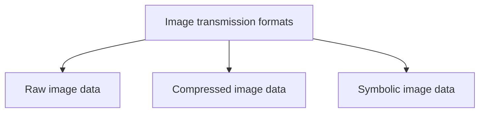

# Image Transmission

**Image transmission** is the sending of **digital images through computer networks**.

## Requirements on the network

| Requirement | Why |
|---|---|
| The network must handle **bursty** data | Image transmission is bursty because of the **large size** of images |
| Transport must be **reliable** | A lost part of an image damages the picture |
| **Time dependence is not dominant** | Unlike audio and video, an image has no real-time deadline |

!!! exam "Compare with audio and video"
    An image is a **discrete** medium (no time component), so its transmission needs **reliable, bursty** transport rather than the **steady, on-time** delivery that continuous media need. This links back to [Media Concepts](../unit-01/media-concepts-and-properties.md).

## Three ways to send an image

The **image size** depends on the **representation format** used for transmission.

### 1. Raw image data transmission

The image is generated by a **video digitiser** and transmitted **in its digital format**.

$$\text{Size} = \text{Spatial resolution} \times \text{Pixel quantization}$$

**Example:** a **640 × 480** image with **8 bits per pixel**:

$$640 \times 480 \times 8 = 2{,}457{,}600 \text{ bits} = 307{,}200 \text{ bytes}$$

### 2. Compressed image data transmission

The image is generated by a video digitiser and **compressed before transmission**.

- Methods such as **JPEG** or **MPEG** are used.
- The **reduction in size** depends on the **compression method and compression rate**.

### 3. Symbolic image data transmission

The image is represented by **symbolic data**: **image primitives** (for example 2D or 3D geometric representation), **attributes** and other **control information**.

- This representation is used in **computer graphics**.
- The **image size equals the size of the structure** that carries the symbolic information.

## Comparison

| | Raw | Compressed | Symbolic |
|---|---|---|---|
| What is sent | Every pixel | Compressed pixel data | Primitives, attributes, control information |
| Size depends on | Resolution × pixel quantization | Compression method and rate | Size of the structure |
| Typical use | Video digitiser output | **JPEG, MPEG** | **Computer graphics** |
| Relative size | Largest | Much smaller | Usually smallest |

!!! info "Extra"
    The "relative size" row is a typical ordering, not a rule: a very complex drawing could produce a symbolic description larger than a compressed small photo. Only states how each size is determined.

## Checkpoint

??? question "Why is image transmission 'bursty' and why is timing not critical?"
    Images are **large**, so they are sent as bursts of data. An image has **no time component**, so unlike audio and video it does not need steady, on-time delivery. It does need **reliable** transport.

??? question "Calculate the raw size of a 640 × 480 image at 8 bits per pixel."
    640 × 480 × 8 = **2,457,600 bits** = **307,200 bytes**.

??? question "When is symbolic image transmission used?"
    In **computer graphics**, where the image is represented by primitives, attributes and control information, and its size equals the size of that structure.
