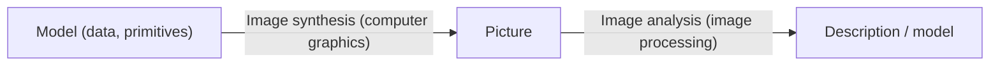
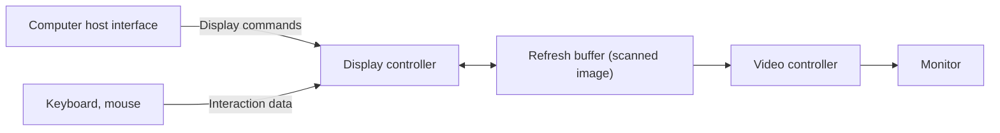

# Image Synthesis and Graphics Systems

## Computer image processing

Two linked ideas, opposite in direction:

- **Computer graphics** is the **pictorial synthesis** of real or imaginary objects **from their computer-based models**.
- **Image processing** is the **converse**: **analysis of scenes**, or **reconstruction of models** from pictures of 2D and 3D objects.

**Computer image processing** therefore has two parts: **image synthesis** (generation) and **image analysis** (recognition).

## Image synthesis

**Image synthesis** deals with the **generation of images of real or imaginary objects**. It is an integral part of all computer **user interfaces** and is indispensable for visualising **2D, 3D and higher-dimensional** objects.

### Applications of image synthesis

| Area | Examples |
|---|---|
| **User interface** | Point-and-click facility; menu-driven systems; GUI windows with icons and menu items |
| **Office automation and electronic publishing** | Desktop publishing; electronic publishing; hypermedia systems |
| **Simulation and animation** for scientific visualisation and entertainment | Simulation of real-time systems; visualising the time-varying behaviour of systems; abstract representation of complex mathematical expressions; models for fluid flow and chemical reaction; cartoons; flying logos and exciting visuals for movies |

## Dynamics in graphics

Graphics are not limited to static images; they can **vary dynamically**. A user can control an animation by adjusting its speed or changing the visible part of a scene. Dynamics are therefore an integral part of (dynamic) graphics. Two kinds:

| | **Motion dynamics** | **Update dynamics** |
|---|---|---|
| Meaning | Objects are **moved or activated relative to a static observer's viewpoint**. Objects may also be static while their **environment moves**. | The **actual change of shape, colour or other properties** of the objects being viewed |
| Example | **Flight simulator** | **Deformation of an in-flight aeroplane structure** |

**Interactive versus non-interactive graphics** : **non-interactive** graphics is passive, with **no communication** between user and computer (the user has no control; a **screen saver** is the example). **Interactive** graphics involves communication between user and computer.

## Framework of an interactive graphics system

The high-level framework of almost any interactive graphics system (for example **SRGP**) has **three software components**. Some sources add a fourth part, the graphics hardware.

### 1. Application model

- Represents the **data or objects to be pictured** on the screen.
- Typically stores **descriptions of primitives** that define the shape of components, the **object attributes**, and **connectivity relationships** describing how the components fit together.
- Stored in an **application database**.
- It is **application-specific** and created **independently of any display system**.

### 2. Application program

Converts the primitive descriptions in the application model into the **procedure calls or commands** the graphics system uses to create an image. This takes **two steps**:

1. **Extraction** of the portions to be viewed from the application database, using a selection or query system.
2. **Conversion** of the extracted geometry into the proper format.

The program produces views by sending the graphics system **a series of graphics output commands**.

### 3. Graphics system

The **intermediary between the application program and the display hardware**, responsible for actually **producing the picture**. It performs two kinds of transformation:

- **Output transformations**: from objects in the application model to a view of the model.
- **Input transformations**: from user actions to application-program inputs that cause the model and/or picture to change.

!!! exam "Exam tip"
    "Explain the framework of an interactive graphics system" is a standard question. Name the **three components** and give **one line of purpose** for each, including the **two steps** of the application program and the **two transformations** of the graphics system.

## Graphics hardware

### Input devices

- **2D input:** mouse, keyboard, data tablet, touch-sensitive panel on the screen.
- **3D and higher-dimensional input:** trackballs, spaceballs, data glove.
- Even **audio communication** can provide input.

### Output: the raster display

Modern visual output uses **raster display devices**, which display primitives in special buffers called **refresh buffers** as pixel components.

- A **raster display** uses a **CRT** with **rows of phosphor dots**; **electron guns** at the back make the dots glow when hit.
- The complete display is a **raster** of **horizontal raster lines**, each made of pixels.
- The **electron beam moves across the screen one row at a time, top to bottom**. The picture information is held in the **refresh buffer**.
- The **video controller reads the refresh buffer** and produces the image, turning the phosphor spots on and off according to the image data. It **samples the entire screen line by line**.
- After each row the beam returns to the start of the next row: this is the **horizontal retrace**.
- A **display controller** receives and interprets the sequence of output commands. In low-end systems such as **personal computers** it is implemented **in software**, as part of a graphics library, and the **refresh buffer is part of CPU memory**.

A typical diagram shows the **computer host interface** sending **display commands** to the **display controller**, which writes the **scanned image** into the **refresh buffer**; the **video controller** reads that buffer and drives the monitor; mouse and keyboard send **interaction data** back to the display controller.

## Dithering

**Dithering** is a process used in output devices (**monitor screens and some printers**) to produce **shades of gray or tints of colour**. The aim is an effect **as close to the original image as possible while using fewer colours**.

It relies on the eye's **spatial integration**: if we view a very small area from a large enough distance, the eye **averages the fine detail** and records only the **overall intensity**.

Dithering is usually called **halftoning**, and the shades of gray are called **halftones**.

### Dither matrix

If a pixel is replaced by an **m × n dither matrix** (an array of dots), the pixel can show **intensity levels from 0 to m × n** (that is, the number of dots lit).

A **2 × 2 matrix** can represent **5 intensity levels**: none, one, two, three or all four dots lit.

### Two techniques

| | **Clustered-dot ordered dithering** (halftoning) | **Dispersed-dot ordered dithering** |
|---|---|---|
| How it works | **Four adjacent pixels** represent the intensity of a single colour; lighting **none, one, two, three or all four** gives different intensities | Uses a 2 × 2 dither pattern with halftone patterns as in the clustered method |
| Used for | Devices that **cannot display individual dots**, e.g. **laser printers** | Devices that **can display individual dots**, e.g. **CRT displays** |
| Result | Different intensities of a colour | A colour CRT shows **125 colours** |

### The 125-colour calculation

Each of the three channels (**red, green, blue**) can show **5 intensities** with a 2 × 2 pattern, so:

$$5 \times 5 \times 5 = 125 \text{ colour combinations}$$

!!! warning "A contradictory phrase"
    One source says dithering is "done by random arrangement of pixels". The main notes describe **ordered** dithering (clustered-dot and dispersed-dot). Use **ordered** in the exam.

## Checkpoint

??? question "Differentiate motion dynamics and update dynamics."
    **Motion dynamics:** objects move or are activated relative to a static observer (flight simulator). **Update dynamics:** the shape, colour or other properties of the objects change (deformation of an aeroplane structure in flight).

??? question "Name the three software components of an interactive graphics system."
    The **application model**, the **application program** and the **graphics system**.

??? question "How can a 2 × 2 dither pattern give 125 colours?"
    A 2 × 2 pattern gives **5 intensities** per channel (0 to 4 dots lit). With red, green and blue channels: 5 × 5 × 5 = **125** colours.
