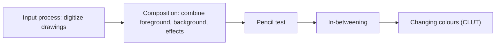

# Animation Basics

!!! source "Source"
    *Unit 4* pp. 35–41; *mul c4* pp. 50–57.

## What is animation?

- **Animation** is making something look and feel alive: it covers **all changes that have a visual effect** (time-varying position, shape, colour, transparency, structure, texture).
- **Computer-based animation** is done with a computer having graphical tools; similar images are displayed quickly. It is based on the **keyframe** concept: a **keyframe** holds the positions (begin and end of a transition) of the objects.

Two categories:

| | Motion dynamics | Update dynamics |
|---|---|---|
| Induces life by | Changing the **position** of an object | Changing the **shape, size or structure** |
| Example | Bouncing ball | Flower blooming from a bud |

## Stages of the process

1. **Input process**: drawings must be **digitized** (optical scanning, data tablet or drawing program) and **filtered** to clean up glitches.
2. **Composition stage**: separate elements (foreground characters, background scenery, special effects) are **combined into the final frames**.
3. **Pencil test**: checks the animation is correct, using an **animation camera**, **before cleaning and painting** the drawings. **Pan and zoom** effects slowly zoom in on a subject and pan between subjects.
4. **In-between process**: frames with intermediate positions between key frames are composed.
5. **Changing colours**: using the CLUT.

## In-betweening and interpolation

- Computer in-betweening uses **interpolation (lerping, linear interpolation)**: given start and end positions, intermediate positions are computed on a straight line.
- Lerp is the easiest method but gives **unrealistic motion**. Example: a ball thrown in the air with only **three key frames** would move in straight segments instead of an arc.
- **Splines** are used to **smooth** the interpolation between key frames.

$$P(t) = (1-t)\,P_{start} + t\,P_{end}, \quad 0 \le t \le 1$$

!!! info "Beyond the lecturer's notes"
    The lerp formula is standard and is not written in the notes. Example: start x = 0, end x = 100, 5 in-betweens means t = 1/6, 2/6, …: x ≈ 16.7, 33.3, 50, 66.7, 83.3.

## Changing colours with a CLUT

- Colours are changed by **manipulating the colour look-up table in the frame buffer**. The simplest method is to **cycle the colours** in the table, changing the colour of various parts of the image.
- **CLUT animation is faster** than sending a whole new pixmap to the frame buffer for every frame.

!!! warning "Source inconsistency"
    *mul c4* slide 56 repeats the "Input process" text under the "In-between process" title (a copy slip). Use the in-between description above.

!!! exam "Exam tip"
    Typical questions: "What is in-betweening? Why are splines used?" and "Explain CLUT animation." Give the lerp weakness (ball path) explicitly.

## Checkpoint

??? question "Differentiate motion dynamics and update dynamics."
    Motion dynamics changes **position** (bouncing ball); update dynamics changes **shape, size or structure** (flower blooming).

??? question "Why is lerp not enough for a thrown ball?"
    It joins key positions by straight lines, so the path is unrealistic; **splines** give a smooth curve.

??? question "Why is CLUT animation fast?"
    Only the small table is changed instead of sending a new pixmap for each frame.
