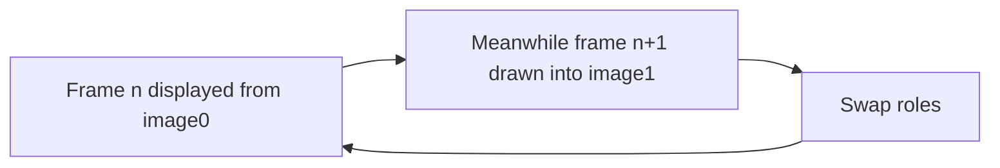

# Animation Display and Transmission

!!! source "Source"
    *Unit 4* pp. 51–54; *mul c4* pp. 67–73.

## Display of animation

- Animated objects (lines, polygons, …) must be **scan-converted into a pixmap in the frame buffer**. To show a rotating object, successive views from slightly different positions are scan-converted one after another.
- A raster screen sweeps **one row at a time, top to bottom**; the **refresh buffer** holds the intensity values for the next picture.
- Scan conversion must be done **at least 10 (preferably 15 to 20) times per second**, so a new image must be created in **no more than 100 ms**. (*mul c4*: at 20 fps manipulation, scan conversion and display must be completed within **50 ms**.)
- Erasing and redrawing within that time is impossible with a **single** buffer; it gives a distracting effect.

### Double buffering

- Solution: **two buffers** (the two halves of the pixmap: **image0** and **image1**). One is **displayed** while the next frame is **built in the other**; then they swap.
- Increases throughput and gives more realistic animation.

## Transmission of animation

Two approaches:

| | Symbolic representation | Pixmap representation |
|---|---|---|
| What is sent | Objects (e.g. circle for a ball) **plus operations** (roll the ball), as text | Scan-converted **images** of the objects |
| Transmission time | **Short** (small size) | **Longer** |
| Display time | Longer (receiver must generate the pixmaps) | **Shorter** |
| Rate depends on | Size of the object structure + size of the operation-command structure + number of objects and commands per second | **Size of one pixmap × images per second** |

- A **pixmap** is a rectangular array of pixel colour values; with **1 bit per pixel** it is a **bitmap**.

!!! example "Pixmap rate"
    320 × 240, 8 bits, 15 images/s: 76,800 bytes × 15 = **1,152,000 bytes/s ≈ 1.1 MB/s**.

!!! exam "Exam tip"
    The standard 5-mark question compares symbolic and pixmap transmission on **transmission time vs display time**.

## Checkpoint

??? question "Why is double buffering needed?"
    A single buffer cannot erase, redraw and show a frame within 100 ms (or 50 ms), causing distracting effects; two buffers allow one to display while the other is filled.

??? question "Which transmission method has faster display?"
    Pixmap: it is directly displayed, but takes longer to transmit.
