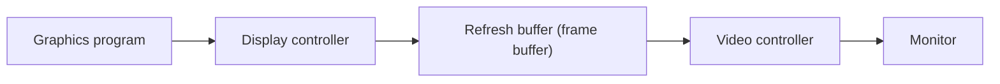

# Computer Video Format

## Standard for digitization: CCIR-601

The **ITU-R** (International Telecommunications Union – Radiocommunications Branch) defined **Recommendation CCIR-601** to standardise digitization of video pictures. Variants exist for **TV broadcasting, video telephony and videoconferencing**.

Video digitizers differ in **image resolution, quantization and frame rate**. Example from the notes: SGI **VINO** digitizer for NTSC: **640 × 480, 8 bits/pixel, 4 frames/second**.

## Raster display architecture

The output of digitized video depends on the input and output devices; the most common display is the **raster display**.

- The **graphics program** creates the high-level image interactively. The **display controller** interprets display commands and writes **pixel values into the refresh buffer**.
- The **video controller** is hardware that reads the pixel values **in time-synchronism with the scanning** and converts them into **red, green and blue analog signals** for the display. It can also access memory.

## Colour look-up table (CLUT)

A range of colour values is stored in a table; each **pixel value is an address** into the table, which holds the corresponding **three colour values**. This is the **colour look-up table**. It saves frame-buffer memory and allows colour changes by editing the table (see [Animation Basics](animation-basics.md)).

## Video controller standards

CGA (Color Graphics Adapter) · EGA (Enhanced Graphics Adapter) · VGA (Video Graphics Array) · 8514/A display adapter mode · XGA (Extended Graphics Array) · Super VGA (SVGA).

!!! info "Extra"
    The resolution table of these standards is often shown only as a picture. Commonly quoted: CGA 320 × 200 (4 colours), EGA 640 × 350 (16), VGA 640 × 480 (16) or 320 × 200 (256), SVGA 800 × 600 and above. Check against your textbook before quoting.

## Video file formats

Video formats use **lossy compression** to cut file size while keeping quality.

| Format | Extension | Codec support | Common use |
|---|---|---|---|
| MP4 | .mp4 | H.264, H.265 | Streaming, mobile devices |
| MOV | .mov | H.264 | Apple ecosystem, editing |
| AVI | .avi | Various | Legacy PC playback |
| MKV | .mkv | Any | Flexible storage |
| WebM | .webm | VP9, AV1 | Web streaming (royalty-free) |

## Raw video size

$$\text{Frame size} = \text{width} \times \text{height} \times \text{bits per pixel}$$
$$\text{Data rate} = \text{frame size} \times \text{frame rate}$$

!!! example "Worked example from the notes: PAL, 352 × 288, 16 bits/pixel, 25 fps"
    - Frame size = 352 × 288 × 16 = **1,622,016 bits** (= 202,752 bytes, about 202.5 KB with decimal kilobytes).
    - Data rate = 1,622,016 × 25 = **40,550,400 bits/s**.
    - In MB/s: 40,550,400 ÷ (8 × 1024 × 1024) = **4.83 MB/s**.

!!! warning "Units"
    The notes convert the frame to KB using 1000 but the rate to MB using 1024 × 1024. In the exam state which unit you use. 202,752 bytes ÷ 1024 = 198 KB.

!!! exam "Quick practice"
    640 × 480, 24-bit, 30 fps: frame = 921,600 bytes; rate = 27,648,000 bytes/s ≈ **26.4 MB/s**; one minute ≈ **1.55 GB**.

## Checkpoint

??? question "What does the video controller do?"
    Reads pixel values from the refresh buffer in step with the scan and converts them into R, G, B analog signals for the monitor.

??? question "What is a CLUT?"
    A table whose entries hold colour values; the pixel value is the address into the table.
