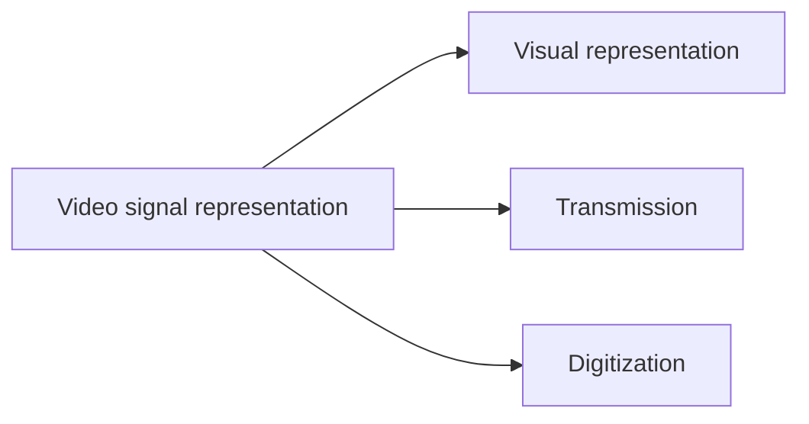

# Video and Visual Representation

## What is video?

- **Video** is a combination of **image and audio**. It consists of a set of **still images called frames**, displayed at a fixed speed called the **frame rate** (frames per second, **fps**).
- Because of **persistence of vision**, the eye cannot separate the frames when they are shown fast enough and sees an **illusion of motion**.
- A frame rate of **20 to 30 fps** gives smooth, realistic motion.
- **Audio** is added and **synchronised** with the apparent movement of the images.
- In a conventional TV the signal is displayed on a **cathode ray tube**; an **electron beam** carries the pattern information (such as intensity) of the scene.

## Three aspects of video signal representation

The goal of **visual representation** is to give the observer as realistic a picture of a scene as possible, so the picture must convey the **spatial and temporal content** of the scene accurately. DVI appears as the following measures.

## 1. Vertical detail and viewing distance

- Geometry of the picture follows the **aspect ratio = picture width / height**. For TV and old PC monitors it is **4/3 = 1.33**; for widescreen it is **16/9**.
- **Vertical detail** is set by the **number of scanning lines**: more lines mean better vertical resolution (1080p has more vertical detail than 720p).
- The full vertical resolution cannot be used because some details fall **between scan lines**. Experiments show the **effective vertical resolution is about 70 %** of the actual one. This factor is the **Kell factor** (0.7), independent of sequential or interlaced scanning.

$$\text{Effective vertical resolution} = \text{active scan lines} \times \text{Kell factor}$$

$$\text{Required horizontal resolution} = \text{aspect ratio} \times \text{effective vertical resolution}$$

!!! example "Worked example (PAL)"
    Active lines = 576. Effective vertical = 576 × 0.7 = **403.2 lines**. Required horizontal = 4/3 × 403.2 = **537.6**.

## 2. Horizontal detail and picture width

- Horizontal detail depends on the **video bandwidth** and the **number of pixels per line**; higher bandwidth gives better horizontal clarity.
- The transmitted picture need not be the same size as the original, but the **aspect ratio must be the same**, otherwise the picture looks too wide or too narrow (stretched).

## 3. Total detail content

The **total number of picture elements** = vertical × horizontal elements. It measures the **amount of information** (texture, edges, fine detail). Complex images need higher resolution and higher bandwidth.

## 4. Perception of depth

- In natural vision, depth comes mainly from the **angular separation of the images** seen by the two eyes.
- On flat TV, depth is **inferred** from perspective, the **focal length of the lens** and the **depth of focus**. Shadows, motion and stereoscopic (3D) vision also help.

## 5. Luminance and chrominance

- Colour is produced by three signals proportional to the **red, green and blue** intensities.
- For transmission and storage a different split is used: **one luminance (brightness) signal Y** and **two colour-difference (chrominance) signals U and V**.
- **Y = 0.30R + 0.59G + 0.11B**, **U = c₁(B − Y)**, **V = c₂(R − Y)**, where c₁ and c₂ are constants.
- Luminance is measured in **nits**. Too high gives glare, too low a dull image.
- Recall colour mixing: yellow + red = orange, yellow + blue = green.

## 6. Temporal aspects of illumination

The eye detects motion when **slightly different still images** follow each other rapidly. This is the basis of cinema and TV. Two conditions are needed: the **rate of succession must be high**, and **vision must persist across the interval** between flashes. Sudden brightness changes cause discomfort, smooth transitions improve quality.

## 7. Continuity of motion

- **Frame rate** = how often new display data is updated per second.
- Motion is seen as continuous only above **15 fps**; below that two frames can be told apart.
- For smooth motion **at least 30 fps** are needed if the scene is **filmed** (not computer-generated). Cinema at **24 fps** often looks strange when large objects move fast and close to the viewer.
- **NTSC**: nominally 30, changed to **29.97 fps**. **PAL**: **25 fps** (25 Hz repetition).

## 8. Flicker

- **Refresh rate** = number of times the display redraws its scan lines per second. If it is too low, brightness fluctuates periodically: the **flicker effect**. A cinema film at 16 pictures per second flickers.
- **Minimum refresh rate to avoid flicker: 50 Hz.**
- Projectors show each frame **2 or 3 times**, so 24 fps film runs at **48 or 72 Hz**.

Two ways to cure flicker:

1. **Raise the refresh rate**. Beyond a limit this may damage the hardware.
2. **Interlaced scanning**: in the first pass the **odd lines** are drawn, in the second the **even lines**. Each frame has **two fields** and the refresh rate seen by the eye doubles.

!!! example "625-line system"
    625 lines per frame → **312.5 lines per field**, of which **292.5 are active (trace) lines** and **20 are vertical retrace**. The same holds for the second field.

## 9. Temporal aspect of video bandwidth

- The eye needs a frame scanned every **1/25 second**; scan rate and resolution fix the bandwidth.
- In one cycle of the video frequency **two horizontally adjacent pixels** can be scanned, hence the divide by 2.

$$\text{Horizontal scan frequency} = b \times c \qquad \text{Video bandwidth} = \frac{a \times b \times c}{2}$$

where **a** = pixels per line (horizontal), **b** = lines (vertical), **c** = frame rate.

!!! example "Worked example"
    a = 1312, b = 800, c = 100 Hz: 1312 × 800 × 100 / 2 = **52,480,000 Hz = 52.48 MHz**.

!!! info "Extra"
    The list is not numbered consistently (a "4" may appear twice, and "8. Flicker" may follow "6."). The nine measures in the order above are the standard list. The flicker minimum is written as 50 cycles/s or 50 Hz. They are the same.

!!! exam "Exam tip"
    "Explain the visual representation of video" is usually answered with the headings above, one or two lines each. Always give the three numbers: **15 fps** (continuity), **25/30 fps** (smooth), **50 Hz** (flicker).

## Checkpoint

??? question "Why is the effective vertical resolution less than the number of scan lines?"
    Details fall between scan lines, so only about **70 % (Kell factor 0.7)** can be used.

??? question "State two ways to avoid flicker."
    Increase the refresh rate (at least 50 Hz) or use **interlaced scanning** (odd lines then even lines, two fields per frame).

??? question "Find the video bandwidth for 800 × 600 at 60 fps (a = 800, b = 600)."
    800 × 600 × 60 / 2 = **14,400,000 Hz = 14.4 MHz**.
