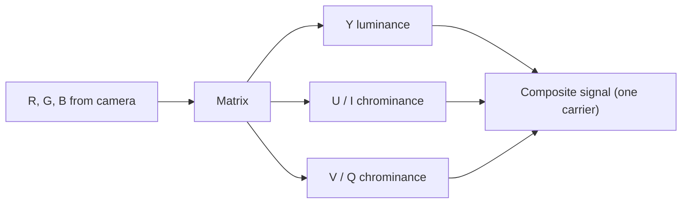

# Video Transmission and Digitization

## Transmission standards and colour encoding

- Transmission standards: **NTSC** (National Television System Committee) and **PAL** (Phase Alternating Line).
- Colour encoding approaches: **RGB, YUV, YIQ** (together called **component signals**) and **composite**.

| | RGB | YUV | YIQ | Composite |
|---|---|---|---|---|
| Signals | Separate R, G, B | Y + U + V | Y + I + Q | All in **one** signal |
| Used by | Computer monitors | PAL TV | **NTSC** TV | Broadcast, low-cost video |
| Strength | Best colour reproduction | Less bandwidth, backward compatible with black and white | Uses eye's colour response | One wire |
| Weakness | Needs more bandwidth and synchronisation of 3 signals | Needs conversion | Needs conversion | Interference between luminance and chrominance |

## RGB signal

- Separate **red, green and blue** signals (three wires per pixel stream). Every colour is a combination of the three primaries by **additive mixing**.
- Values are normalised so that **R + G + B = 1 gives neutral white**.
- Used by **computer monitors**; best reproduction, but needs more bandwidth and tight synchronisation.

## YUV signal

- The eye is **more sensitive to brightness (luminance) than to colour (chrominance)**, so brightness is separated from colour.

$$Y = 0.30R + 0.59G + 0.11B$$
$$U = 0.493\,(B - Y) \qquad V = 0.877\,(R - Y)$$

- **Y** is luminance, **U** is the blue chrominance, **V** is the red chrominance.
- Because chrominance carries less information, U and V are **scaled down** (the 0.493 and 0.877 factors) to save bandwidth.
- A **black-and-white TV** can use Y alone to show a colour broadcast.
- YUV is sometimes described as using **two wires** (one for luminance, one for combined chrominance), gives **less crosstalk** and is also known as **S-video**.

!!! warning "Watch out"
    The factors 0.493 and 0.877 are the usual scaling constants. The coefficients 0.30, 0.59, 0.11 sum to 1, as they must.

## YIQ signal

- Similar to YUV, used by the **NTSC** colour system. **Y** is luminance, **I** and **Q** are chrominance.
- It takes advantage of **human colour response**: the eye is more sensitive to **orange–blue (I)** than to **purple–green (Q)**, so **Q needs less bandwidth**.

!!! info "Extra"
    The standard NTSC equations are Y = 0.299R + 0.587G + 0.114B, I = 0.596R − 0.274G − 0.322B, Q = 0.211R − 0.523G + 0.312B. Slides often show them only as pictures, so learn the *idea* (Y plus two chrominance, Q needs least bandwidth) and quote the equations only if your teacher expects them.

## Composite signal

- All information (luminance plus chrominance) is **mixed into one signal on a carrier wave**. The components RGB, YUV or YIQ must be combined.
- Because they share one signal, **interference** may occur, so a suitable **modulation** is used. Example: in NTSC the chrominance signals **I and Q are combined into a chroma signal kept at a high frequency within the channel shared with luminance Y**.
- Component (YUV) signals give **better quality** because colour and brightness stay separate.

## Digitization

- **Digitization** converts the analog video signal to digital form: better quality, easier storage and transmission.
- Two steps: **sampling** digitizes the **spatial position** (divide the picture into an **M × N array of points**); **quantizing** digitizes the **colour/brightness** (divide the signal into a range of grey-level values).
- Finally, the **digital motion video** is created by digitizing the pictures **temporally** (frame after frame).

!!! exam "Exam tip"
    A frequent 5-mark question: "Differentiate component and composite video." Component: separate R,G,B or Y,U,V or Y,I,Q signals, best quality, more bandwidth. Composite: one signal, cheap, interference between Y and chroma.

!!! info "Extra"
    Do not confuse video digitization (sampling and quantizing) with image synthesis and analysis from Unit 3.

## Checkpoint

??? question "Why does YUV save bandwidth?"
    The eye is less sensitive to colour than to brightness, so the **chrominance signals U and V are scaled down**, needing less bandwidth than the luminance.

??? question "Which colour system does NTSC use and which component needs least bandwidth?"
    **YIQ**; **Q** (purple–green), since the eye is less sensitive to it.

??? question "Define sampling and quantizing."
    Sampling digitizes the **spatial position** (M × N points); quantizing digitizes the **colour/brightness** into grey-level values.
