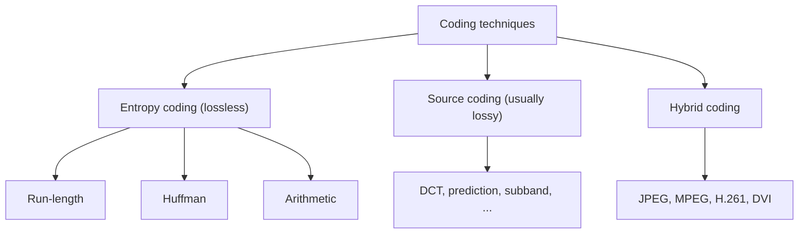

# Categories of Coding

!!! source "Source"
    *Unit 5* pp. 9, 16–22.

## Entropy coding

- Used for **any medium**, regardless of its characteristics.
- Data is viewed as a **sequence of digital values; semantics are ignored**.
- **Lossless**: the data after decoding is **identical** to the data before encoding.
- Examples: **run-length, Huffman, arithmetic** coding.

## Source coding

- Takes the **semantics** of the information into account.
- With lossy compression the decoded data is **similar but not identical**. Example (audio): melody, rhythm and overall quality are kept, but **high-frequency sounds may be removed or reduced**.
- For speech, a large reduction comes from transforming the **time-dependent signal into the frequency domain** and coding the **formants**.
- Examples: DCT, prediction, subband coding.

## Hybrid coding

Combines **source coding and entropy coding** to improve the compression ratio while keeping quality. Examples: **MPEG, JPEG, H.261, DVI**.

| Step | Goal | Methods |
|---|---|---|
| 1. Source stage | Remove perceptually insignificant data | Images: **DCT** (JPEG) and quantization. Audio: psychoacoustic masking, formant/pitch modelling. Video: **motion compensation**, spatial and temporal redundancy removal |
| 2. Entropy stage | Compress the residual **without further quality loss** | Huffman, arithmetic, **RLE**, Lempel-Ziv (LZ77, LZ78) |

!!! exam "Exam tip"
    The three-column table "entropy / source / hybrid" with ignores-or-uses semantics, lossless-or-lossy, and examples is a standard 6-mark answer.

## Checkpoint

??? question "Why is entropy coding lossless but source coding lossy?"
    Entropy coding only re-codes the values (no information dropped); source coding discards information the user cannot perceive.

??? question "Why is JPEG called hybrid?"
    It uses DCT and quantization (source coding) followed by Huffman/arithmetic coding (entropy coding).
