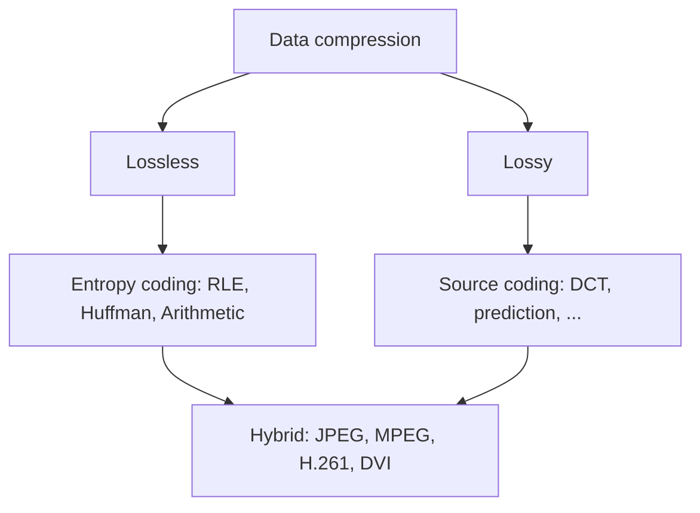

# Unit 5: Data Compression

**6 hours · approx. weeks 6–7**

!!! success "Ready"
    Topic notes, practice questions and class slides are complete for this unit. Parts marked *Extra* go beyond the core topics and come from standard textbook knowledge.

## What this unit covers

| Syllabus topic | Notes page |
|---|---|
| 5.1 Basic concepts, coding requirement | [Basic Concepts and Coding Requirements](basics.md) |
| 5.2 Categories: source, entropy and hybrid coding | [Categories of Coding](categories.md) |
| 5.3 Run-length coding, Huffman coding (and arithmetic coding) | [Run-Length and Huffman Coding](rle-and-huffman.md) |
| 5.3 Prediction coding and adaptive compression | [Prediction and Adaptive Compression](prediction-and-adaptive.md) |
| 5.4 JPEG | [JPEG](jpeg.md) |
| 5.4 MPEG, H.261 (px64) and DVI | [MPEG, H.261 and DVI](mpeg-h261-dvi.md) |

Also: [Class Slides](slides.md) and [Practice Questions](practice.md).

## Quick map

!!! exam "Where marks come from"
    Almost every paper has a **Huffman tree numerical**, a short note on **RLE**, a question on **JPEG steps** and one on **MPEG I/P/B frames**. Practise the Huffman example until you can do it in five minutes.
