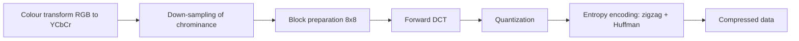
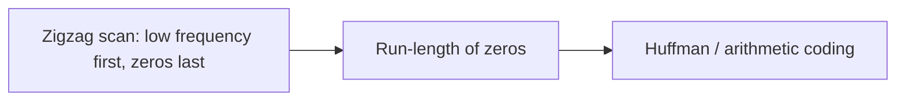

# JPEG

**JPEG (Joint Photographic Experts Group)** is a **lossy** standard for compressing pictures and graphics. (MPEG compresses video, MP3 audio.) It is a **hybrid** coder.

## Why JPEG works on 8 × 8 blocks

- An image is a 2D array of pixels. A **grayscale 640 × 480** picture has 307,200 pixels = **2,457,600 bits**; a **colour** picture of the same size is **7,372,800 bits** (× 24 bits).
- JPEG divides the picture into **8 × 8 pixel blocks** because the number of operations per picture then grows with the block size squared and stays small.
- The whole idea is to change the picture into a **linear set of numbers that reveals the redundancies**, which are then removed by lossless methods.

## The compression pipeline

Decompression reverses the steps: **decoding → de-quantization → inverse DCT → up-sampling → colour transform back**.

!!! info "Extra"
    The course text's schematic lists colour transform (RGB to YUV) and down-sampling before DCT. The reason is the same as in [Video](../unit-04/video-transmission.md): the eye is less sensitive to chrominance, so Cb and Cr can be stored at lower resolution (for example one sample per 2 × 2 pixels).

## Discrete Cosine Transform (DCT)

- Separates the image into parts of **different spatial frequencies**.
- **Most of the information sits in the very low-frequency components**; the rest have small values that need few bits.
- Each 8 × 8 block (64 samples) becomes **64 DCT coefficients**:
  - the top-left coefficient is the **DC coefficient** (the block's average level);
  - the other 63 are **AC coefficients**, from low to high frequency toward the bottom right.
- The forward DCT (FDCT) itself is reversible apart from rounding; the **loss happens in quantization**.

$$F(u,v)=\frac{2}{N}\,C(u)C(v)\sum_{x=0}^{N-1}\sum_{y=0}^{N-1} f(x,y)\cos\!\Big[\tfrac{(2x+1)u\pi}{2N}\Big]\cos\!\Big[\tfrac{(2y+1)v\pi}{2N}\Big]$$

You are not usually asked to evaluate the formula, but you should recognise it as the **2D DCT** (N = 8 for JPEG).

## Quantization

- JPEG uses a **table of 64 entries**; each entry is the divisor for one DCT coefficient. Coefficient ÷ table entry, **rounded to an integer**.
- **Less important (high-frequency) coefficients** get large divisors and mostly become **0**. This discarding is the **lossy** step. A larger table gives more compression and lower quality.

!!! example "Tiny example"
    Coefficient 83 with divisor 16: 83 ÷ 16 = 5.19 → **5**. On decoding 5 × 16 = 80, not 83: the error is the loss. A coefficient 6 with divisor 40 becomes 0 and is lost entirely.

## Entropy encoding

1. **DC coefficients** are treated **separately** from AC coefficients (DC is coded as a difference from the previous block).
2. **AC coefficients** are read in **zigzag order**, from the top left toward the bottom right, so the many **zeros are grouped together** at the end.
3. The zero runs are then packed (run-length idea) and **Huffman coded** (or arithmetic coded in the expanded mode).

## JPEG modes

| | Lossy sequential DCT-based mode | Expanded lossy DCT-based mode |
|---|---|---|
| Bits per sample | **8** | **8 or 12** |
| Entropy coding | **Huffman only** | **Huffman and arithmetic** |
| Build-up | **Sequential**: parts of the picture are drawn one after another | Sequential **and progressive** |
| Progressive | – | A very rough picture appears first and is **refined progressively** by **layered coding** |

!!! info "Extra"
    JPEG also defines a **lossless mode** (predictive, no DCT) and a **hierarchical mode** (multiple resolutions). These are named in many textbooks (four modes in total).

!!! exam "Exam tip"
    Answer "Explain the JPEG compression process" with the five-block diagram (DCT → quantization → zigzag/run-length → Huffman) and one sentence on where the loss occurs (quantization).

## Checkpoint

??? question "Where does JPEG lose information?"
    In **quantization**, when DCT coefficients are divided and rounded, especially the high-frequency ones.

??? question "Why the zigzag scan?"
    It orders the coefficients from low to high frequency so the zeros are concentrated at the end, making run-length and Huffman coding efficient.

??? question "What is the DC coefficient?"
    The top-left DCT coefficient: the average (lowest-frequency) level of the 8 × 8 block.
