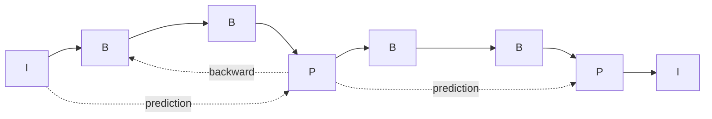

# MPEG, H.261 and DVI

## MPEG

- The **Moving Pictures Experts Group** was formed by **ISO** to set standards for multimedia applications that use **video with sound**.
- The video data rate must not exceed **1,856,000 bits/s**; audio uses **32 to 448 kbit/s**, giving acceptable video and audio quality.
- MPEG builds on **JPEG** (a moving picture is a sequence of still images) and on **H.261**, with which compatibility was sought in some areas.

### Two kinds of redundancy

| | Spatial redundancy | Temporal redundancy |
|---|---|---|
| Where | **Within one frame**: adjacent pixels correlate | **Between consecutive frames**: much content stays static |
| Method | **Intra-frame** compression, like JPEG | **Inter-frame** compression |
| Steps | **Macroblocks** (e.g. 16 × 16) → **DCT** → **quantization** (lossy) → **entropy coding** | **Motion estimation** (find macroblock movement, giving **motion vectors**) → **motion compensation** (predict from reference I/P frames, code only the **residual**) |

### Frame types

| Frame | Meaning | Reference | Compression |
|---|---|---|---|
| **I** (intra) | Coded **independently**, each frame as a JPEG picture (Y, Cb, Cr) | None | Relatively **small** |
| **P** (predictive) | Coded relative to the **preceding I or P frame** using motion estimation and compensation | Past | Significantly **higher** |
| **B** (bidirectional) | Uses **past and future** I/P frames | Past and future | **Highest**; needs **re-ordering** because the future frame must be coded first |

- I-frames must appear at **regular intervals** so that corruption in one frame does not spread. The number of frames between successive I-frames is the **group of pictures (GOP)**.
- The number of frames between a P-frame and the preceding I-frame is the **prediction span**.

!!! example "Typical sequence (for example I, B, B, P, B, B, P … I)"
    Display order: **I B B P B B P B B I**. Coding order: **I P B B P B B I B B**, because each B needs the next P first.

## H.261 (px64)

!!! info "Extra"
    Only says H.261 existed before MPEG and that MPEG tries to stay compatible with it. The usual textbook description:

    - ITU-T standard for **video telephony and videoconferencing** over **ISDN**.
    - Called **px64** because the data rate is **p × 64 kbit/s**, with **p = 1 to 30** (64 kbit/s to about 1.92 Mbit/s).
    - Frame formats **CIF 352 × 288** and **QCIF 176 × 144**, up to 30 frames/s.
    - Uses **DCT**, quantization, **motion compensation** (I and P frames, no B-frames) and Huffman coding. Needs **real-time** coding and decoding with low delay.

## DVI (Digital Video Interactive)

!!! info "Extra"
    DVI appears as DVI as a hybrid-coding example and nothing else. Textbook summary: an **Intel/IBM** technology (originally from RCA) for **interactive video on CD-ROM**, with two compression levels, **presentation-level video (PLV)** compressed offline at high quality and **real-time video (RTV)** compressed on the fly at lower quality, using hardware chips. It was a forerunner of the MPEG approach.

!!! exam "Exam tip"
    "Explain the I, P and B frames of MPEG" is the favourite. Draw the sequence with arrows, give the reference for each type, the GOP definition, and mention that B frames give the best compression but need re-ordering.

## Checkpoint

??? question "Why does MPEG have I-frames at regular intervals?"
    So decoding can start or recover at that point and errors do not propagate; it also gives random access.

??? question "Why do B-frames need re-ordering?"
    They depend on a future reference frame, which must be decoded before the B-frame.

??? question "Differentiate spatial and temporal redundancy."
    Spatial: similarity within a frame (removed by DCT-based intra coding). Temporal: similarity between frames (removed by motion estimation and compensation).
