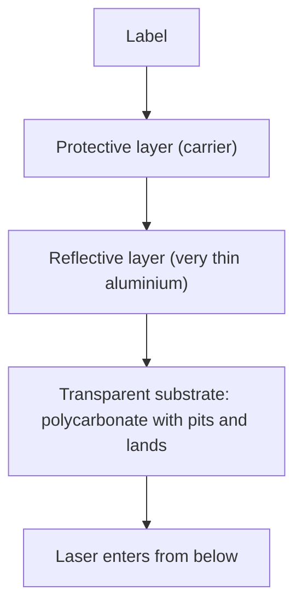

# Basic Technology

## History

| Year | Event |
|---|---|
| 1973 | Video Long Play (VLP) published (Philips Technical Review) |
| 1983 | CD-DA available (Philips and Sony), **Red Book** |
| | CD-ROM: **Yellow Book** (physical), High Sierra proposal, **ISO 9660** (logical) |
| 1986–88 | **CD-I** announced; **Green Book** (1988); CD-ROM/XA announced (Philips, Sony, Microsoft, 1988) |
| 1987 | DVI first presented |
| | CD-WO and CD-MO: **Orange Book** |
| 1996 | **DVD** |

## Pits and lands

- Information is stored in a **spiral-shaped track** as a series of **pits and lands** in the substrate layer.
- A **transition from pit to land or land to pit = '1'**; **between transitions a run of '0's**. (This is differential NRZ coding.)
- Track density about **16,000 turns per inch (tpi)**: track pitch **1.6 µm** (a floppy disk has 96 tpi).
- The laser is focused on the **reflective layer**: **lands reflect almost totally, pits scatter** the light, so the reflected light level changes.

!!! example "Check"
    25.4 mm ÷ 1.6 µm = 15,875 ≈ **16,000 tpi**.

## Physical structure (three layers)

1. **Transparent substrate** (polycarbonate) with pits and lands, transparent for the laser beam.
2. **Reflective layer** (aluminium, very thin).
3. **Protective layer** (polycarbonate, used as carrier) with the label.

Disc thickness about **1.2 mm**.

## Player mechanism

A **laser** beam is reflected from below the disc; a **prism** diverts the reflected beam to a **photo cell**; a **lens** focuses the beam. The wavelength is about 780 nm and it can be focused on a spot of about 1 µm.

## Advantages of optical storage media

| Advantage | Reason |
|---|---|
| **High data density** | **1.66 bits/µm** of track; 16,000 tpi against 96 tpi |
| **Long-term storage** | Surface is **out of focus**, so insensitive to dust and scratches |
| **Few head crashes** | Distance between head and surface **> 1 mm** |
| **Adequate error correction** | See [CD-DA](cd-audio.md) |
| **Each digital disc equals the master** | Copies are exact |

!!! exam "Exam tip"
    A 5-mark "Explain how data is stored and read on a CD" = spiral track, pits/lands, 1 at every transition, three layers, laser reflection.

## Checkpoint

??? question "How are bits represented on a CD?"
    A change between pit and land (either way) is a 1; no change gives 0s between the 1s.

??? question "Why are CDs insensitive to dust and scratches?"
    The reading laser is focused on the reflective layer, so dirt on the outer surface is out of focus.
