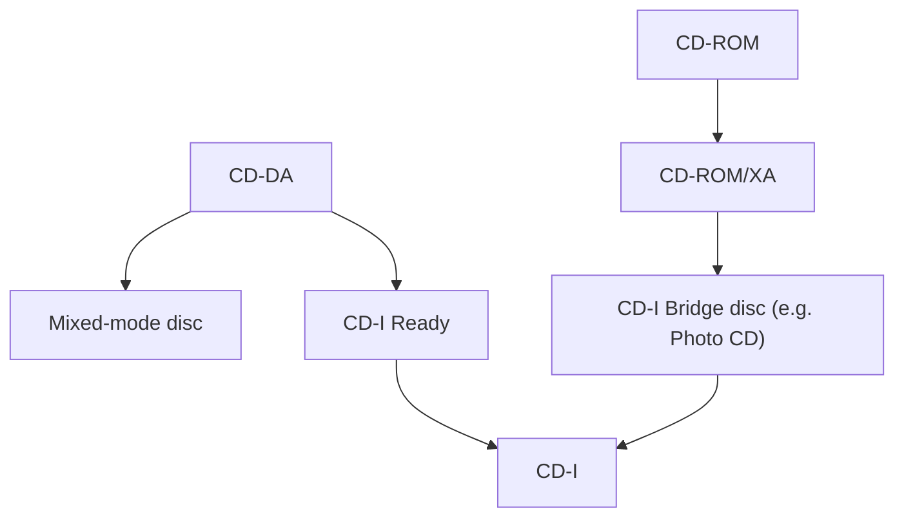

# CD-I, CD-I Ready, Bridge Disc and Photo CD

## CD-Interactive (CD-I)

- Developed by **Philips and Sony**; announced **1986**; **Green Book 1988** (extension of the Red and Yellow Books). Aimed at the **consumer market**.
- A **system**: CD-ROM-based format with interleaving of different media, compression algorithms, **software** and **hardware (decoder)**.
- **CD-RTOS**: real-time operating system, an extension of **OS-9**.
- Hardware: **680xx processor**, video and audio chips, CD player with CD-DA parts, mouse/joystick interface, CD controller, connection to RGB monitor or TV; size of a video recorder.

### CD-I audio levels

| | CD-DA | CD-I A (hi-fi) | CD-I B (mid-fi) | CD-I C (speech) |
|---|---|---|---|---|
| Sampling | 44.1 kHz | 37.8 kHz | 37.8 kHz | 18.9 kHz |
| Bandwidth | 20 kHz | 17 kHz | 17 kHz | 8.5 kHz |
| Coding | 16-bit PCM | 8-bit ADPCM | 4-bit ADPCM | 4-bit ADPCM |
| S/N | 98 dB | 90 dB | 60 dB | 60 dB |
| Playing time (stereo / mono) | 74 min | 2.4 h / 4.8 h | 4.8 h / 9.6 h | 9.6 h / 19.2 h |
| Fidelity | CD | LP | FM | AM |

### CD-I video

| Mode | Description | Size per image |
|---|---|---|
| **YUV** (natural images) | 360 × 240, 18 bit/pixel, 262,144 colours | 360 × 240 × 18 bit = **194,400 bytes** |
| **CLUT** (simple graphics) | 720 × 240, 4 bit/pixel, 16 colours | 720 × 240 × 4 bit = **86,400 bytes** |
| **RGB** (very good graphics) | 360 × 240, 5 bit per component + 1 = 16 bit | 360 × 240 × 16 bit = **172,800 bytes** |
| Animations with few colours | Run-length coding | about 10,000–20,000 bytes/image |

Video can also be coded with **MPEG**.

!!! warning "Slip in the slide"
    The RGB mode is said to give "65538 colours"; 2¹⁶ = **65,536**.

## CD-I Ready format

A disc playable on **both CD-DA and CD-I players**. The **track pregap** (normally 2–3 s) is extended to **at least 182 s** and carries the CD-I data. Audio players ignore it. Three play modes: (1) standard audio only, (2) read and display the pregap data only, (3) load the pregap information into the player's RAM, then play audio while showing it.

## CD-I Bridge disc

Playable on **CD-ROM/XA players and CD-I players**. All data tracks are in **CD-ROM mode 2**; **no CD-I tracks appear in the table of contents**.

## Photo CD

- By **Eastman Kodak and Philips**, announced **1990**; an example of a **bridge disc**, based on **CD-WO**. Readable on Photo CD, CD-I and CD-ROM/XA players; written by special Photo CD or CD-WO writers.
- Photos taken with conventional cameras are **digitized** (8 bits luminance and 8 bits for each chrominance component) and written to the CD.
- Each photo is stored as an **ImagePac** with **five resolutions (hierarchical coding)**, about **3–6 MB** per ImagePac.

| Image type | Compression | Lines | Columns |
|---|---|---|---|
| Base/16 | none | 128 | 192 |
| Base/4 | none | 256 | 384 |
| Base | none | 512 | 768 |
| 4 Base | compressed | 1,024 | 1,536 |
| 16 Base | compressed | 2,048 | 3,072 |

!!! warning "Label slip"
    The extracted slide labels the second row "base/14"; the sequence 128 → 256 → 512 shows it is **base/4**.

Uses: professional and private applications, simultaneous display of several images, image editing, integration into documents.

## Checkpoint

??? question "What makes a disc a 'bridge disc'?"
    It works in both CD-ROM/XA and CD-I players: all data in mode 2 and no CD-I tracks in the TOC (example: Photo CD).

??? question "How is the 16 Base Photo CD image 'hierarchical'?"
    Each photo has five resolutions stored together, from 128 × 192 up to 2,048 × 3,072.
