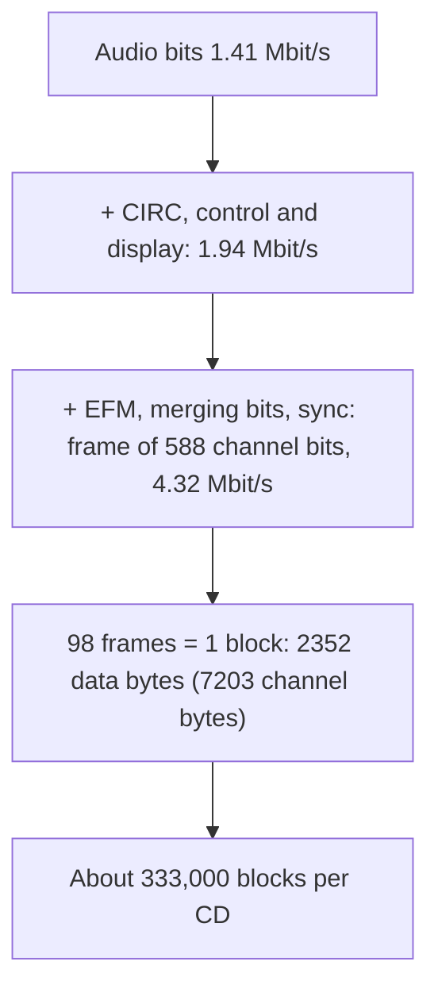

# CD-ROM and CD-ROM/XA

## Why CD-ROM differs from CD-DA

Computer data is **much more sensitive to errors** than audio (no repetition, interpolation or dropping possible) and needs **smaller units for random access**. So CD-ROM adds **extra error correction** and uses **blocks** (sectors) instead of whole tracks.

## Standard: Yellow Book

- **Mode 1**: for **any data** (computer data).
- **Mode 2**: for **compressed audio and video** data.
- They **cannot be combined within a single track**; a track holds only CD-DA audio or only CD-ROM data.
- **Mixed-mode disc**: data tracks first, then audio tracks.

## Structure: from audio bits to blocks

- **75 blocks per second** (single speed). 1,411,200 ÷ 75 ÷ 8 = **2,352 bytes per block**.
- 74 min × 60 × 75 = **333,000 blocks**.

!!! warning "Watch out"
    - A block holds **98 frames** (2,352 ÷ 24 audio bytes per frame; 98 × 588 channel bits = 57,624 bits = 7,203 bytes).
    - Do not round the block count to 330,000: it is exactly **333,000**.

## Mode 1 block (2,352 bytes)

| Field | Bytes |
|---|---|
| Sync | 12 |
| Header (minutes, seconds, block number, mode) | 4 |
| **User data** | **2,048** |
| EDC (error detection) | 4 |
| Blank (unused) | 8 |
| ECC (Reed-Solomon) | 276 |

- Error rate after correction **10⁻¹²**.
- **Capacity** = 333,000 × 2,048 = **681,984,000 bytes ≈ 650 MB**.
- **Data rate** = 2,048 × 75 = 153,600 bytes/s ≈ **150 KB/s** (single speed).
- Used by most CD-ROM applications.

## Mode 2 block

| Field | Bytes |
|---|---|
| Sync | 12 |
| Header | 4 |
| **User data** | **2,336** |

- Capacity = 333,000 × 2,336 = 777,888,000 bytes ≈ **741.85 MB**.
- Data rate = 2,336 × 75 = **171 KB/s** (single speed).
- Problem: **mixing mode 1 and mode 2 blocks** in one track.

## Average access time

- **Synchronization time**: adapt the internal clock (milliseconds).
- **Seek time**: move the laser to the radius, at most **1 s**.
- **Rotation delay** (CLV): find the sector and adapt disc speed, about **300 ms**.
- Maximum access time **> 1 s**; average **> 300 ms** (with caching). Reading **audio and other data simultaneously in mode 1 is not possible**.

## File system

- CD-ROM itself has **no logical file format and no directory specification**.
- **High Sierra proposal**: industry group, the first file system, leading to **ISO 9660**.
- **ISO 9660**: **directory tree** with file information; **path table** (list of all directories, direct access to files at any level); **file interleaving**.
- First track: **16 blocks (sectors 0–15) system area**, then volume descriptors: **primary descriptor** (length of file system, length and address of path table), supplementary descriptors, and a **volume descriptor terminator**.
- **Logical block size** 512, 1,024 or 2,048 bytes (powers of 2); files begin at the start of a logical block.

## CD-ROM Extended Architecture (CD-ROM/XA)

- Announced **1988** by **Philips, Sony and Microsoft**. Goal: **simultaneous transfer of various media**.
- Based on **CD-ROM mode 2, ISO 9660 and CD-I**; an extension of the Yellow Book.
- **Blocks of different media are interleaved in the same track**; a new track type carries compressed audio (**ADPCM**), video, images, text and programs.
- Two block formats:

| | Form 1 | Form 2 |
|---|---|---|
| Fields | sync 12, header 4, **subheader 8**, user data **2,048**, EDC 4, ECC 276 | sync 12, header 4, subheader 8, user data **2,324**, EDC 4 |
| Use | **Text and program data** (better error handling) | **Compressed audio and video** |
| Error handling | EDC + ECC | EDC only (4 bytes) |
| Data | – | **13 % more** user bytes (2,324 ÷ 2,048 = 1.135) |

### CD-ROM/XA audio levels

| | CD audio | Level B stereo | Level B mono | Level C stereo | Level C mono |
|---|---|---|---|---|---|
| Compression | 1 | 4 : 1 | 8 : 1 | 8 : 1 | 16 : 1 |
| Coding | PCM | ADPCM | ADPCM | ADPCM | ADPCM |
| Sampling | 44,100 Hz | 37,800 Hz | 37,800 Hz | 18,900 Hz | 18,900 Hz |
| Capacity | 74 min | 4 h 48 min | 9 h 36 min | 9 h 36 min | 19 h 12 min |
| Data rate | 176 KB/s | 43 KB/s | 22 KB/s | 22 KB/s | 11 KB/s |

### Drawbacks of XA

- Compression is only **referenced**; coding and decoding are not part of CD technology. **MPEG audio is not compatible** (MPEG does not use ADPCM).
- Interleaving different data in one track needs a **special disc layout**, a suitable audio level and **complex application development**.

!!! exam "Exam tip"
    The favourite is "Compare CD-ROM mode 1 and mode 2" (2,048 vs 2,336 user bytes; EDC/ECC present vs absent; 650 MB vs 741.85 MB; 150 vs 171 KB/s) and "Explain the CD-ROM/XA forms".

## Checkpoint

??? question "Why does mode 1 hold less user data than mode 2?"
    Mode 1 spends bytes on EDC, blank and 276 ECC bytes for reliability; mode 2 has none, so 2,336 bytes are user data.

??? question "Calculate the capacity of a mode-1 CD."
    333,000 blocks × 2,048 bytes = 681,984,000 bytes ≈ 650 MB.
