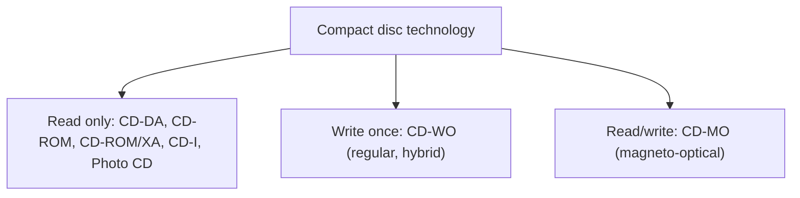

# Unit 6: Optical Storage Media

**4 hours · approx. weeks 8–9**

!!! success "Ready"
    Topic notes, practice questions and class slides are complete for this unit. Blu-ray is written from standard textbook knowledge.

## What this unit covers

| Syllabus topic | Notes page |
|---|---|
| 6.1 Basic technology | [Basic Technology](basic-technology.md) |
| 6.2 Video disk fundamentals, Blu-ray disk | [Video Disks: Laser Vision, DVD and Blu-ray](video-disks.md) |
| 6.3 CD audio | [CD Audio (CD-DA)](cd-audio.md) |
| 6.3 CD-ROM and Extended Architecture | [CD-ROM and CD-ROM/XA](cd-rom.md) |
| 6.3 Further CD-ROM based developments (extras) | [CD-I, CD-I Ready, Bridge and Photo CD](cd-i-and-photo-cd.md) |
| 6.4 CD Write-Once and CD Magneto-Optical | [CD-WO and CD-MO](cd-wo-and-cd-mo.md) |

Also: [Class Slides](slides.md) and [Practice Questions](practice.md).

## The family of discs

| Book | Standard |
|---|---|
| Red | CD-DA |
| Yellow | CD-ROM (physical format; logical format ISO 9660) |
| Green | CD-I |
| Orange | CD-WO (Part II) and CD-MO (Part I) |

!!! exam "Where marks come from"
    Typical questions: CD-DA specification and calculations, EFM, CIRC, CD-ROM mode 1 vs mode 2, XA forms, CD vs DVD table, CD-WO principle and sessions.
