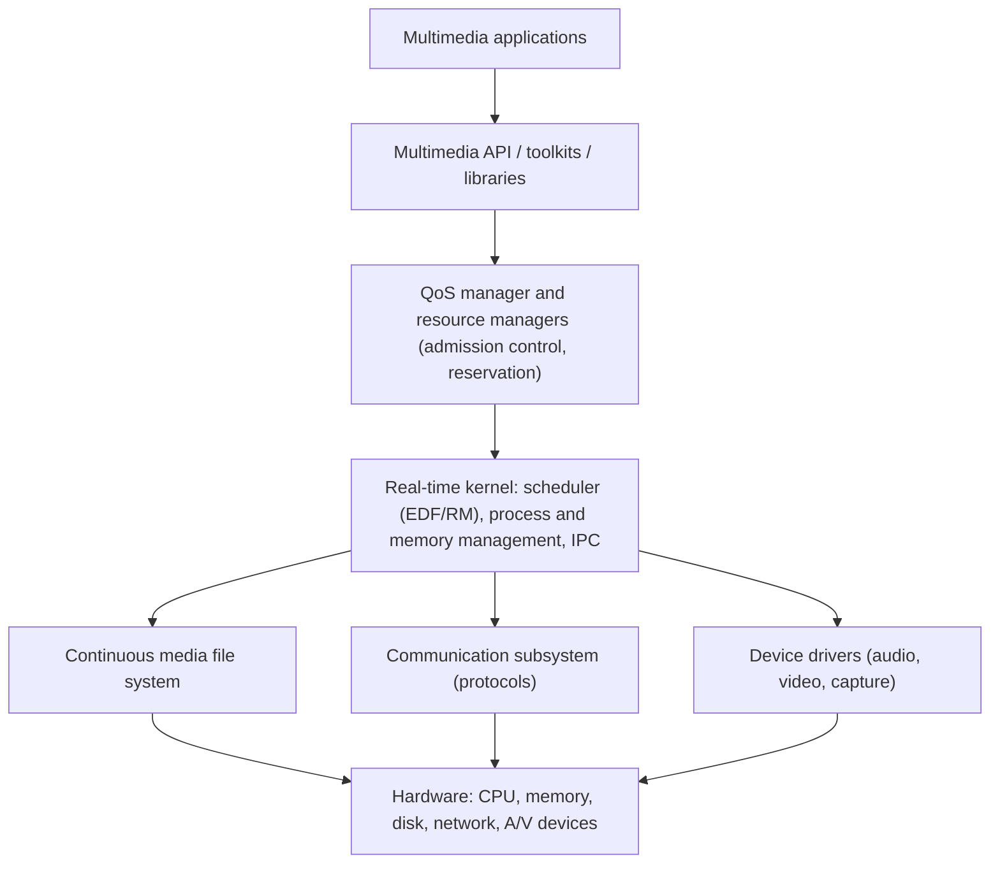

# System Architecture

## Goal

Provide, on top of the hardware, a **real-time environment** that serves continuous media with guaranteed QoS **together with** ordinary applications.

## Layers

## Components

| Component | Role |
|---|---|
| **Real-time scheduler** | EDF or rate monotonic scheduling of continuous media processes |
| **Resource managers and QoS manager** | Admission control, reservation, monitoring (see [Resource Management](resource-management.md)) |
| **Memory management** | Pinned (non-swappable) buffers, avoid page faults, avoid copying (shared buffers) |
| **Continuous media file system** | Placement and **disk scheduling** (for example EDF or SCAN-EDF) for steady rates; large files; multiple streams |
| **IPC** | Timely transfer of continuous data between processes |
| **Device drivers** | Hide audio/video hardware, with time-bounded interrupt handling |
| **Network subsystem** | Real-time transport (see [Unit 8](../unit-08/index.md)) |

## Architectural approaches

| Approach | Idea | Comment |
|---|---|---|
| **Extend a conventional OS** | Add real-time classes, QoS and a continuous media file system to Unix or Windows | Practical; incomplete guarantees |
| **Real-time micro-kernel** | Small kernel offers scheduling, memory, IPC; services run as user-level servers | Predictable and flexible |
| **Dedicated multimedia OS** | Built around QoS and resources from the start (the Nemo idea in [Unit 11](../unit-11/system-software.md)) | Best guarantees, little software |

!!! info "Design rules"
    Keep **kernel paths short and bounded**, **avoid copying** data between layers, make resource accounting explicit, and let applications **adapt** when the system cannot give full QoS.

## Checkpoint

??? question "Why does a multimedia OS pin memory and avoid copying?"
    Page faults and copies add unbounded delay and CPU load; pinned shared buffers give predictable timing.

??? question "Name the two main ways of building a multimedia OS."
    Extend a conventional OS with real-time features, or build on a real-time micro-kernel.
