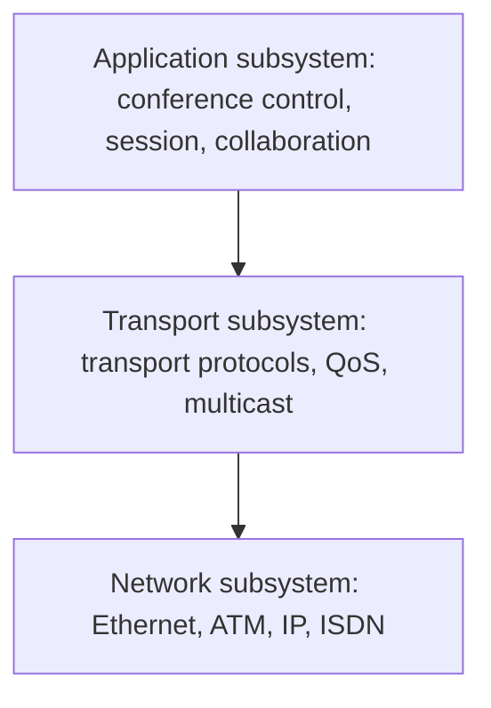

# Introduction to Multimedia Communication

**Multimedia communication** is the exchange of multimedia data (text, image, audio, video) between systems over a network, often with **real-time** requirements, in a **distributed** environment.

## Why it is harder than data communication

| Aspect | Traditional data | Multimedia |
|---|---|---|
| Volume | Small | **Very large** (video of several Mbit/s) |
| Time | Not critical | **Delay and jitter** critical for continuous media |
| Loss | Not tolerated (retransmit) | **Some loss tolerated** (audio, video) |
| Pattern | Bursty, point to point | **Continuous and bursty**, often **multicast** |
| Synchronisation | None | **Between streams** (lip sync) |

## Communication patterns

- **Point to point (unicast)**, **point to multipoint (multicast, broadcast)**, **multipoint to multipoint** (conferencing).
- **Interactive** (conference, delay about 150 ms or less one way) and **retrieval** (video on demand, start-up delay tolerated).

## Layered view

The textbook divides a multimedia communication system into an **application subsystem** and a **transport subsystem** on top of the network, with **QoS and resource management** across all of them.

## Network requirements

1. **High and guaranteed bandwidth**.
2. **Bounded end-to-end delay** and **low jitter**.
3. **Multicast** support.
4. **Reliability** adjusted to the medium (some errors acceptable).
5. **QoS guarantees** and resource reservation.

## Checkpoint

??? question "Why is multimedia traffic harder to carry than file transfer?"
    It needs large bandwidth, bounded delay and jitter, multicast and stream synchronisation; it tolerates some loss but not late delivery.
