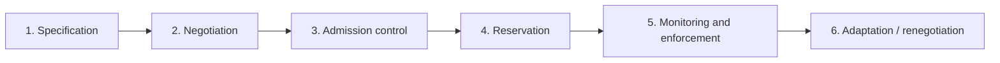

# Quality of Service and Resource Management

!!! info "Not in the previous lecturer's notes"
    Written from the syllabus and standard textbook knowledge (mainly Steinmetz and Nahrstedt, *Multimedia: Computing, Communications and Applications*). Check details against your prescribed textbook.

**Quality of Service (QoS)** is the set of parameters describing how well a service is delivered, and the **guarantee** that it will be delivered at that level.

## QoS layers

| Layer | Example parameters |
|---|---|
| **User (perceptual)** | Picture quality (good, fair), sound quality (CD, phone) |
| **Application** | Frame rate, resolution, colour depth, compression method |
| **System** | CPU time, memory, buffers |
| **Network** | **Throughput**, **delay**, **jitter**, **loss rate** |

## Network QoS parameters

| Parameter | Meaning |
|---|---|
| **Throughput (bandwidth)** | Data rate needed (for example 1.5 Mbit/s for MPEG-1 video) |
| **Delay (latency)** | End-to-end time; **≤ 150 ms** for interactive audio |
| **Jitter** | Variation of delay; audio can tolerate about 10 ms |
| **Loss / error rate** | Fraction lost; audio and video tolerate small loss |

## Guarantee classes

| Class | Meaning |
|---|---|
| **Guaranteed (deterministic)** | Always met; worst-case reservation |
| **Predictive / statistical** | Met with a given probability |
| **Best effort** | No guarantee |

## QoS management steps

1. **Specification:** the user states the QoS (for example flow specification: rate, delay, loss).
2. **Negotiation:** user, application and network agree on achievable values.
3. **Admission control:** accept only if existing guarantees stay safe.
4. **Resource reservation:** reserve bandwidth, CPU and buffers (RSVP).
5. **Monitoring and enforcement (policing):** check that the sender keeps to its specification and the network keeps its promise.
6. **Adaptation:** if QoS drops, the application lowers its rate (for example fewer frames) or renegotiates.

## Traffic shaping

To keep the traffic within the agreed specification, the sender (or network) **shapes** it.

- **Leaky bucket:** data enters a bucket and leaves at a **constant rate**, smoothing bursts; excess overflows (dropped).
- **Token bucket:** tokens arrive at rate *r* into a bucket of size *b*; a packet needs a token. Allows **bursts up to b** while keeping the **average rate r**.

!!! example "Token bucket"
    r = 100 packets/s, b = 20 tokens. After a quiet period the bucket is full; a burst of 20 packets can go at once, then the sender is limited to 100 packets/s. In any interval *t* the maximum is about **b + r·t** (compare the LBAP in [Unit 7](../unit-07/resource-management.md)).

## Resource management in the communication system

- Resources: **link bandwidth, router/switch buffers, CPU of end systems**.
- The **end-to-end guarantee** needs **resource reservation at every hop** plus **scheduling** (for example weighted fair queuing) in routers.
- **Scalability** and **cost** are the practical difficulties; many networks use **DiffServ** (classes) instead of per-flow reservation.

!!! exam "Exam tip"
    A five-mark "QoS" answer: define QoS, list throughput, delay, jitter, loss, the three guarantee classes and the negotiation → admission → reservation → monitoring chain.

## Checkpoint

??? question "Differentiate leaky bucket and token bucket."
    Leaky bucket outputs at a fixed rate (no bursts out); token bucket allows bursts up to the bucket size while keeping an average rate.

??? question "What is admission control in a network?"
    A decision whether a new flow can be accepted without violating guarantees already given.
