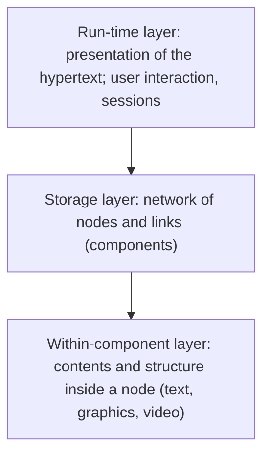

# Hypermedia Systems: Architecture, Nodes and Pointers

## Nodes

A **node** (also card, page, frame) is a unit of information: text, image, audio, video, or a **composite** node containing other nodes. Good practice: one node per **single idea**, so it can be linked in several contexts.

## Links (pointers)

A **link** connects a **source** to a **destination**. The **anchor** is the active part inside a node (a word, a region of a picture, a time range of a video).

| Property | Options |
|---|---|
| **Direction** | Unidirectional or bidirectional |
| **Cardinality** | One-to-one, one-to-many, many-to-many |
| **Storage** | **Embedded** in the node (as in HTML) or **external** (kept in a separate link base) |
| **Type** | Navigational, reference, annotation, structural (part-of), temporal (for time-based media) |
| **Activation** | By the reader (click), automatic, or by time |

A link may also be to a **point** or a **range** in the destination, and may trigger an **action** (play a clip).

## Architecture: the Dexter hypertext reference model

The **Dexter model** describes hypertext systems in three layers:

| Layer | Role |
|---|---|
| **Run-time layer** | How the hypertext is **presented** and how users interact |
| **Storage layer** | The **database of nodes (components) and links** with their identifiers and anchoring |
| **Within-component layer** | The **content and internal structure** of each node, outside the model |

Interfaces: **presentation specifications** (between run-time and storage) and **anchoring** (between storage and within-component).

## A typical hypermedia system

A **hypermedia system** has an **authoring** part (create nodes and links), a **database** (nodes, link base, indexes), a **browser/navigation** part (follow links, maps, history, search) and, for multimedia, a **presentation engine** for time-based media. Examples: HyperCard, early CD-ROM encyclopedias, the **World Wide Web**.

!!! exam "Exam tip"
    Draw the three-layer Dexter diagram, name the two interfaces, and give anchors, links, nodes with one line each.

## Checkpoint

??? question "What is an anchor?"
    The part of a node that is the start or end of a link (a word, a picture area, a video segment).

??? question "Which Dexter layer stores the links?"
    The storage layer.
