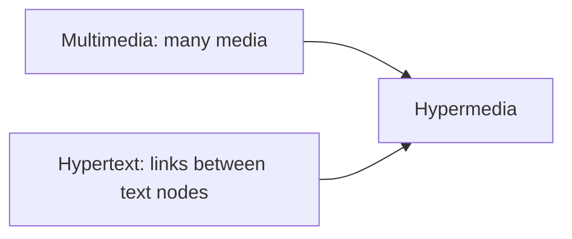

# Hypertext, Hypermedia and Multimedia

## Hypertext

**Hypertext** is **text organised as a network of linked nodes** that the reader can follow in a **non-linear** order, in contrast with ordinary text that is read from start to end.

- Idea: **Vannevar Bush**'s **Memex** (1945), a machine to link and follow associative trails.
- The word **hypertext** was coined by **Ted Nelson** (1965). **Xanadu** was his project; **HyperCard** (1987) and the **World Wide Web** (1989–91, Berners-Lee) made it popular.

## Hypermedia

**Hypermedia** extends hypertext so that the nodes may contain **any media** (graphics, audio, video), not only text.

## Multimedia

**Multimedia** is the **integrated presentation of several media**; it does not by itself require non-linear navigation.

| | Multimedia | Hypertext | Hypermedia |
|---|---|---|---|
| Media | Several | **Text only** | **Several** |
| Structure | Often linear or time based | **Linked network** | **Linked network** |
| Navigation | May be sequential | **Non-linear, by links** | **Non-linear, by links** |
| Example | A film, a slide show | A help system of text pages | The Web with images and video |

!!! info "Hypermedia = hypertext + multimedia"
    Hypermedia is the **union**: the **links** of hypertext with the **media** of multimedia.

## Advantages and problems

- **Advantages:** flexible access, associative browsing, user control, rich presentation.
- **Problems:** **disorientation ("lost in hyperspace")**, **cognitive overhead** (too many choices), difficulty keeping a sense of the whole.
- **Remedies:** **overview maps**, **history** and back button, **bookmarks**, **guided tours**, clear link labels.

## Checkpoint

??? question "Differentiate hypertext and hypermedia."
    Hypertext links text nodes only; hypermedia links nodes of any media.

??? question "Name two navigation aids."
    Overview maps, history/back, bookmarks, guided tours.
