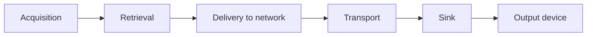

# Synchronization in a Distributed Environment (item 10.6)

Synchronization is **more complex** in a distributed environment than in a local one, because the source, the network and the sink are separate and have separate clocks. The elements:

1. **Transport of the synchronization specification.** Three approaches:
    1. deliver the **complete synchronized information before the presentation** starts;
    2. use an **additional synchronization channel**;
    3. use a **multiplexed data stream** (specification and media in one stream).
2. **Location of synchronization:** synchronize media objects by **combining them into a new media object**, at the source or at the sink.
3. **Clock synchronization:** the **accuracy between the clocks of source and sink** nodes must be considered.
4. **Multiple communication relations:** communication patterns with **several sinks** need run-time handling.
5. **Multi-step synchronization:** it must be maintained through all steps so that the sink can do the **final synchronization**:
    1. during **object acquisition** (digitizing a video frame);
    2. during **retrieval** (synchronized access to frames of stored video);
    3. during **delivery of LDUs to the network**;
    4. during **transport**;
    5. at the **sink**;
    6. **within the output device**.

!!! example "Why clocks matter"
    If the sender's clock runs 0.1 % fast relative to the receiver's, after 10 minutes (600 s) the receiver has accumulated 600 × 0.001 = **0.6 s** of drift, far beyond the ±80 ms lip-sync limit. Clock synchronization or buffer adaptation is needed.

## Checkpoint

??? question "List three ways to deliver the synchronization specification."
    Complete before the start; an extra synchronization channel; multiplexed with the media stream.

??? question "Name the six steps of multi-step synchronization."
    Acquisition, retrieval, delivery to network, transport, sink, output device.
