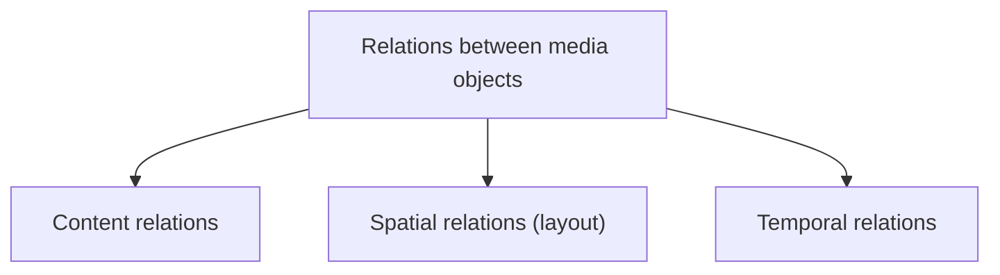

# Notion of Synchronization

!!! source "Source"
    *Unit 10 – Synchronization* handout pp. 1–2; slide deck pp. 2–4.

## Introduction

The word **synchronization** refers to **time**. In multimedia it means the **temporal relation between media objects** in the system: between **time-dependent** (continuous) objects and between time-dependent and **time-independent** (discrete) ones. A common example is the synchronization of **visual and acoustical information in television**.

Slide-deck view: coordinating several media types in time to give a **seamless presentation**, for example lip movement matching speech.

## Basic synchronization issues

| Relation | Defines | Example |
|---|---|---|
| **Content relation** | **Dependency of media objects on some data** | A **spreadsheet** and the **graph** drawn from its data |
| **Spatial relation (layout)** | The **space** used on the output device at a given time; on a 2D device, the 2D area | Position and size of a video window on the screen |
| **Temporal relation** | **Temporal dependencies** between objects; of interest when time-dependent objects exist | **Video and audio recorded at a concert** |

## Intra-object and inter-object synchronization

| | Intra-object (intra-media) | Inter-object (inter-media) |
|---|---|---|
| Concerns | The **time relation between the presentation units (LDUs) of one** time-dependent object | The synchronization **between media objects** |
| Example | Frames of a video of a **bouncing ball**: at **25 fps each frame is shown for 40 ms** | A presentation that starts with an **audio/video sequence**, followed by **several pictures** and an **animation commented by an audio sequence** |

!!! example "Check"
    1 s ÷ 25 frames = **40 ms** per frame.

## Live and synthetic synchronization

| | Live | Synthetic |
|---|---|---|
| Goal | **Exactly reproduce the temporal relations as they were at capture** | Temporal relations are **artificially specified** |
| Example | **Video conferencing** | Moving along the path of a **car race** (a pre-authored presentation) |

## Hard and soft synchronization (slide deck)

- **Hard sync:** strict timing, for example a **live news broadcast**.
- **Soft sync:** some delay is acceptable, for example **offline playback**.
- Intra-media example: video frame order; inter-media example: audio + video; a music video whose beat matches the visuals.

!!! exam "Exam tip"
    "Explain the basic synchronization issues" = content, spatial, temporal relations with one example each. Then intra vs inter and live vs synthetic as two small tables.

## Checkpoint

??? question "Give an example of a content relation."
    A graph that depends on the data of a spreadsheet.

??? question "What is the display time of one frame in a 30 fps video?"
    1 ÷ 30 s ≈ 33.3 ms. (The notes' 25 fps case gives 40 ms.)

??? question "Is video conferencing live or synthetic synchronization?"
    Live, because the capture-time relations must be reproduced.
