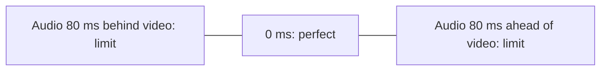

# Presentation Requirements

!!! source "Source"
    *Unit 10 – Synchronization* handout pp. 2–3; slide deck p. 5.

For correct delivery at the user interface, synchronization is essential. A **presentation requirement** consists of:

- for **intra-object** synchronization: the **accuracy of delays** in presenting the **LDUs** (logical data units);
- for **inter-object** synchronization: the **accuracy of the parallel presentation** of media objects.

## Lip synchronization

**Lip synchronization** is the temporal relation between an **audio** and a **video** stream when a **person speaks**.

- The time difference between related audio and video LDUs is the **skew**.
- Streams in perfect synchronization have **skew = 0 ms**.
- Lip synchronization is tolerated within a skew of **−80 ms (audio behind video)** to **+80 ms (audio ahead of video)**.

## Pointer synchronization

In a **CSCW** (computer-supported cooperative work) environment, cameras and microphones are attached to each user's workstation. A speaker uses a **pointer** to indicate elements of a graphic while talking, so **audio and pointer** must be synchronized. Experiments gave:

| Case | Tolerated skew |
|---|---|
| **Audio ahead of pointing** | **750 ms** |
| **Pointing ahead of audio** | **500 ms** |

## Other requirements from the slide deck

| Requirement | Meaning | Example |
|---|---|---|
| **Timeliness** | Items shown at the right time | Subtitles match spoken dialogue |
| **Continuity** | No skipping or breaks | Smooth streaming |
| **Skew tolerance** | Allowed deviation | Lip sync **< 80 ms** |
| **Latency** | Delay from source to display | Delay in live sports commentary |
| **Jitter** | Variation of delay | Choppy audio in a video call |

!!! warning "Wording"
    The slide deck states lip sync as "< 80 ms" and the handout as "−80 ms to +80 ms". They agree: the allowed band is **±80 ms**.

!!! info "Beyond the lecturer's notes"
    Textbooks also give bounds for other combinations (for example audio with animation, audio with image slides, audio-audio), generally looser than for lip sync. Check the prescribed textbook if your exam is set from it.

!!! exam "Exam tip"
    Learn the three numbers **±80 ms**, **750 ms** and **500 ms**, and define **skew**.

## Checkpoint

??? question "Define skew."
    The time difference between related LDUs of two streams, for example audio and video.

??? question "State the tolerated lip-sync skew."
    From −80 ms (audio behind video) to +80 ms (audio ahead of video).
