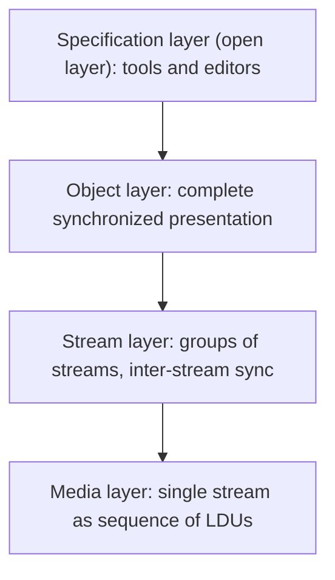

# Reference Model for Multimedia Synchronization

## Why a reference model?

Synchronization is needed at several points and by several kinds of users, from a device programmer to an author. A **reference model** divides the problem into **layers**, each giving a **synchronization mechanism through an interface**.

- The interfaces can be used to **specify** or **enforce** temporal relations.
- Each interface defines **services**, offering the user a way to **state requirements**.
- Each layer can be used **directly by an application** or **by the next higher layer** to build its own interface.

It lets us compare existing systems, place each function where it belongs, and design new systems in a modular way.

## The four layers 

| Layer | Operates on | Abstraction offered | Functions |
|---|---|---|---|
| **Media layer** | **One continuous media stream**, a sequence of **LDUs** | A **device-independent interface** with operations such as **read and write** | Simple implementations, or ones that handle **two interleaved** streams |
| **Stream layer** | **Streams and groups of streams** | Continuous media as a **data flow with implicit time constraints**; **individual LDUs are not visible** | Runs in a **real-time environment**; the application **starts, stops and groups** streams and defines **QoS** in timing parameters; **inter-stream synchronization** inside a group; the application synchronizes streams with **time-independent** media |
| **Object layer** | **All media types**; hides the difference between **discrete and continuous** media | The complete, **synchronized presentation** | Takes a **synchronization specification** as input; **computes and executes the presentation schedule** including discrete objects and **calls to the stream layer**; closes the gap between the needs of a synchronized presentation and the stream services |
| **Specification layer** | Tools | An **open layer with no explicit interface** | **Synchronization editors, multimedia document editors, authoring systems**; **converts** specifications to the object-layer format; **maps user-level QoS** to the qualities of the object-layer interface |

## Alternative naming

Some courses name the layers **Media** (raw files such as .mp4, .mp3), **Stream** (streams and buffering, for example YouTube), **Session** (manages sessions, for example Netflix) and **Sync** (coordinates all media timing).

!!! warning "Which to write in the exam"
    The textbook version (media, stream, **object, specification**) is standard and the assignment questions ask for the "four-layer synchronization reference model". Write the textbook version and, if useful, add one line that some courses call the upper layers "session" and "sync".

!!! exam "Exam tip"
    A common 8-mark question: "Why is a reference model required? Discuss the four-layer model." Give the reasons above, a four-row table, and the idea that **each layer uses the one below**.

## Checkpoint

??? question "Which layer hides the difference between discrete and continuous media?"
    The object layer.

??? question "Which layer has no explicit interface?"
    The specification layer: it holds tools such as editors and authoring systems.

??? question "At which layer are individual LDUs visible?"
    The media layer; the stream layer sees a data flow, not individual LDUs.
