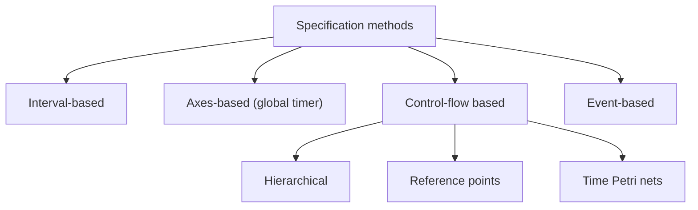

# Synchronization Specification

A **synchronization specification** of a multimedia object describes **all temporal dependencies** of the objects it contains. It is **produced with the tools of the specification layer** and **used at the interface to the object layer**.

## What it contains

1. **Intra-object** synchronization specification for each media object.
2. **QoS description** for intra-object synchronization.
3. **Inter-object** synchronization specification.
4. **QoS description** for inter-object synchronization.

QoS levels: **QoS for one media object**, **for two related objects**, and **for several related objects**.

## Categories of specification methods

| Category | Idea |
|---|---|
| **Interval-based** | Relates the **time intervals of presentation** of objects (for example *before, meets, overlaps, during*); durations for time-dependent and time-independent objects |
| **Axes-based** | Relates **presentation events to axes shared by the objects**: a **global timer** or **virtual axes** |
| **Control-flow based** | The presentation flow is synchronized at **predefined points**: **basic hierarchical specification**, **reference points**, **time Petri nets** |
| **Event-based** | **Presentation actions are started by synchronization events**: **start**, **stop**, **prepare** presentation |

**Scripts** are a **textual description** of a synchronization scenario; they are powerful because they provide a **full programming environment**.

Slide-deck techniques: **timeline models** (Gantt style), **time-stamping** (for example MP4 metadata) and **script-based** (for example **SMIL**); example: slide narration in an e-learning module.

## Requirements on a specification method

1. Support **object consistency** and maintenance of the specification.
2. Give an **abstraction of the content** of a media object so temporal relations can be stated.
3. Describe **all types of synchronization relations** easily.
4. **Integrate time-dependent and time-independent** media.
5. Support **QoS requirements**.
6. Support **hierarchical levels** of synchronization.

!!! example "Interval-based example"
    Slide 1 (10 s) is shown during the narration clip (10 s); slide 2 starts when slide 1 ends and the animation **overlaps** the last 5 s of slide 2. Each statement relates two intervals.

!!! info "Extra"
    The thirteen interval relations of Allen's algebra (before, meets, overlaps, starts, during, finishes, equals and their inverses) underlie interval-based specification. Time Petri nets use places and transitions with durations. Learn the names above, not the formalism, unless your teacher asks.

!!! exam "Exam tip"
    "Briefly describe synchronization specification" = what it contains, the four method categories with one line each, and one or two of the six requirements.

## Checkpoint

??? question "Which method uses a global timer?"
    Axes-based specification.

??? question "What are the three actions of event-based synchronization?"
    Start, stop and prepare presentation.
