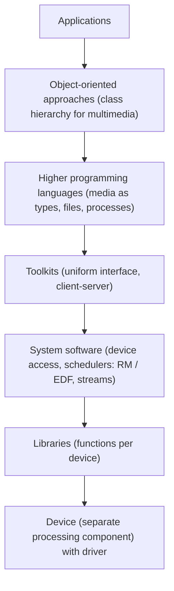

# Abstraction Levels and Libraries

## The state of the art (introduction)

Most commercially available multimedia applications are written in **procedure-oriented languages**. Application code is highly **dependent on the hardware**, so changing a multimedia device often needs **re-implementation**. Operating system extensions try to solve this, and there are different ways to **access and represent multimedia data**.

## Abstraction levels

**Abstraction levels** in programming are different approaches with a varying **degree of detail** for **representing, accessing and manipulating data**.

| Level (low to high) | Idea |
|---|---|
| **Device** | A component for continuous media can exist **separately** in the computer. It is **not part of the OS** but is directly accessible to every component and application |
| **Library** | The **simplest** level; functions for **controlling the hardware** with specific device-access operations |
| **System software** | Processing of continuous data becomes **part of the OS**; needs **schedulers** such as **rate monotonic** or **earliest deadline first**; a **device driver** embedded in the OS simplifies access and scheduling |
| **Toolkit** | A simpler programming-environment approach to control audio and video; **hides process structures** |
| **Higher programming language** | The language contains **abstractions of multimedia data** (a *higher procedural language*) |
| **Object-oriented approach** | First introduced to **reduce complexity**; gives a **class hierarchy** for manipulating multimedia |

Higher in the diagram means **more abstraction, more hardware independence, easier programming**, usually at some cost in speed.

## Libraries

- **Libraries** contain **sets of functions used to process continuous media**. They are **supplied with the corresponding hardware**.
- Some are **extensions of the GUI**; others are **control instructions passed as control blocks to the drivers**.
- Very useful at the **OS level**. Because the OS gives **insufficient support for continuous data** and there is **no integration into the programming environment**, a **variety of interfaces and libraries** will always exist.
- Libraries **differ in their degree of abstraction**, and there is **no agreement on which functions are best** for different drivers.

!!! exam "Exam tip"
    "Explain the abstraction levels in multimedia programming" = the diagram and one line per level, from library at the bottom to object-oriented at the top.

## Checkpoint

??? question "Why do libraries not solve portability?"
    Each device vendor supplies its own library with its own functions and abstraction level, so applications stay hardware dependent.

??? question "Which level introduces schedulers such as EDF and RM?"
    System software.
