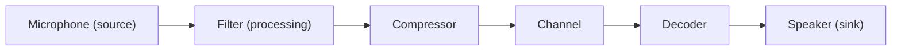

# Object-Oriented Approaches

The **object-oriented (OO) approach** was introduced to **reduce complexity** and to enable **reuse of software components**. Its basic ideas are **data encapsulation** and **inheritance**, with **classes, objects and methods** instead of functions and data structures.

## Basic concepts

| Concept | Meaning | Example |
|---|---|---|
| **Class** | A collection of objects with the same properties and behaviour; a **blueprint**. Creating an object is **instantiation** | Class **Circle** with attributes x-coord, y-coord, radius a and methods findArea(), findCircumference(), scale() |
| **Object** | A real-world element with **identity**, **state** and **behaviour**; physical (a car) or conceptual (a project) | A particular circle |
| **Inheritance** | A subclass acquires attributes and methods of a **parent (super)class**: an **"is-a"** relation, giving **code reuse**; the subclass may add or modify | Cow **is a** Mammal |
| **Polymorphism** | Same operation name, **different implementation** by object; **common external interface** with different internals | findArea() in Circle and Square |

## Multimedia classes (ways to build the hierarchy)

### Application-specific metaphors as classes
A **metaphor** is a set of UI visuals, actions and procedures exploiting what users already know from other domains. A class hierarchy designed for **one application** is simple, but the **reuse advantage is lost**.

### Application-generic metaphors as classes
Combine functions **common to all applications** into classes; an application is defined by **binding** these classes, and **application-specific subclasses inherit the general methods**.

### Devices as classes
Objects reflect the **physical view**: each device is an object representing its **behaviour and interface**. Similar methods such as **start, stop, seek** are defined **device-independently**. Some units handle **several media together** (a computer-controlled **VCR** or **laser disc player** binds video and audio). Abstract devices such as **camera** and **monitor** can be defined. Defining a general interface for many audio/video units is a **difficult design task**.

### Processing units as classes
**Source objects, destination objects and combined source-destination objects** that process continuous data between them. Like a **"Lego" system**, a **data-flow path** is built by connecting outputs to inputs, directly or through **channel objects**.

### Media as classes
A **media class hierarchy** relates the media: **Medium** → *Acoustic medium* (music, speech, with *Opus, Note, Audio_Block, Sample value*), *Optical medium* (video, *Video_Scene, Image, Image_Segment, Pixel*, line, column; animation; text), *other continuous medium*, *discrete medium*. A class such as **Pixel** uses **multiple inheritance**. A special property of all multimedia objects is the **continuous change of their internal state** during their life span; data transfer lasts as long as the **connection is active**.

### Communication-specific metaphors as classes
For **distributed environments**, classes tied to a communication system. **Blakowski** defines **information, presentation and transport** classes: **information objects** build **presentation objects** and are converted into **transport objects** for transmission.

## Simple and compound multimedia objects (BMO, SMO, CMO)

| Term | Meaning |
|---|---|
| **BMO (Basic Multimedia Object)** | The **long data string** of an SMO. **SG:BMO** (segmented): **definite length** (single image, screen or text record). **ST:BMO** (streamed): **a priori undetermined duration** (real-time voice or video) |
| **SMO (Simple Multimedia Object)** | A BMO with **two headers** |
| **CMO (Compound Multimedia Object)** | A combination of SMOs with **two headers**: **orchestration header** (temporal relations; the SMOs are individually synchronized **and jointly orchestrated**) and **concatenation header** (**logical and spatial** relations) |

Example: an **image**, a **voice annotation** and a **pointer movement** annotating the voice form one CMO.

A CMO can be created and managed by **N users at multiple locations**. The system must allow users to **create** SMOs and CMOs, **share, store or modify** a CMO, **preserve temporal, logical and spatial relations** at all users at all times, **define, manage and monitor** the activity, and **monitor and restore services** after failure or degradation.

!!! exam "Exam tip"
    Short answers: class/object/inheritance/polymorphism with the Circle and Mammal examples; BMO/SMO/CMO with the two CMO headers. Long answer: the multimedia class approaches, one paragraph each.

## Checkpoint

??? question "What are the two headers of a CMO?"
    The orchestration header (temporal relations) and the concatenation header (logical and spatial relations).

??? question "Give an example of polymorphism."
    findArea() in Circle and Square: same name, different calculation.

??? question "Difference between SG:BMO and ST:BMO?"
    SG:BMO has a definite length (single image); ST:BMO has an undetermined duration (live voice or video).
