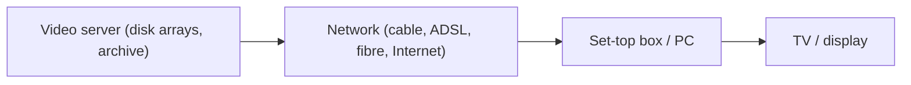

# Application Areas in Detail

!!! info "Beyond the lecturer's notes"
    The lecturer's file covers application *classes*, system types and components and the development cycle only. This page is written from standard textbook knowledge to cover the rest of syllabus 12.1–12.4. Check details against your prescribed textbook.

## 12.1 Video on demand (VoD)

**Video on demand** lets a user **select and watch a video at any time**, with **VCR-like controls** (play, pause, fast forward, rewind).

| Type | Meaning |
|---|---|
| **True VoD** | Each user gets an **individual stream**, started instantly, full interactivity |
| **Near VoD** | The same film is started on **several channels at staggered times** (for example every 15 min); users wait for the next start; much cheaper |

Requirements: **large server storage and bandwidth** (MPEG-1 about 1.5 Mbit/s, MPEG-2 about 4 to 6 Mbit/s per stream), **real-time disk scheduling**, **admission control** and **QoS guarantees**, **billing and security**.

!!! example "Server capacity"
    A server with 1 Gbit/s output can serve about 1,000 ÷ 4 = **250** MPEG-2 streams at 4 Mbit/s each.

## 12.2 Video conferencing

**Video conferencing** carries **audio and video** (plus shared tools) between **two or more sites** in real time.

- **Point to point** and **multipoint** (a **multipoint control unit, MCU**, mixes or switches streams).
- **Desktop** and **room-based** systems; features: **shared whiteboard, application sharing, file transfer, chat**.
- **Requirements:** **low delay (about 150 ms or less)**, small jitter, **lip synchronisation (±80 ms)**, **bandwidth adaptation**, **echo cancellation**.
- **Standards:** **H.320** (ISDN), **H.323** (packet networks), H.261 video coding ([Unit 5](../unit-05/mpeg-h261-dvi.md)), and **SIP** with RTP today.

## 12.3 Educational and industrial applications

**Educational:** **computer-based training (CBT)**, **e-learning** and **virtual classrooms**, **simulations and virtual laboratories**, **educational games**, **multimedia encyclopedias**, **interactive tutorials** with self-assessment. Benefits: **self-paced**, **rich explanation** with animation and video, **immediate feedback**. Limits: development cost and the need for good instructional design.

**Industrial:** **employee training** and **safety simulations**, **product demonstration and catalogues**, **kiosks**, **CAD/CAM visualisation**, **process monitoring** with video and sensor data, **remote maintenance** with video and annotation, **corporate presentations**.

## 12.4 Information systems, archives, entertainment, editors, trends

**Information systems (kiosks):** public **touch-screen terminals** giving **maps, timetables, tourist and government information**; need **simple navigation** and **robust hardware**.

**Multimedia archives and digital libraries:** collections of **text, images, audio and video** stored **digitally** with **metadata**. Needs: **digitisation and compression**, **indexing** (text, **content-based retrieval** of images and video), **search**, **long-term preservation**, **access control and copyright**, **distributed access** over networks. Examples: national archives, museum collections, film and music archives.

**Media entertainment:** **computer games**, **interactive and digital TV**, **music and video streaming**, **special effects** in films, **theme-park rides**.

**Media editors:** tools to create and modify media: **image editors** (Photoshop), **audio editors**, **non-linear video editors** (cut, effects, transitions on a timeline), **animation tools** (Flash, Maya), **authoring tools** that integrate media.

**Trends:** **streaming** and **mobile multimedia**, **high-definition and 4K video** with efficient codecs, **virtual, augmented and mixed reality**, **cloud-based** services, **AI-assisted** creation, search and captioning, **5G** low-latency networks, **social and user-generated** media.

!!! exam "Exam tip"
    For "short notes", give a definition, a block diagram or a list of requirements, and two examples. For VoD always name true vs near VoD.

## Checkpoint

??? question "Differentiate true and near video on demand."
    True: separate stream per user, immediate start. Near: staggered start times on shared channels.

??? question "List the requirements of a digital library."
    Digitisation and compression, indexing and retrieval, preservation, access control and copyright, networked access.
