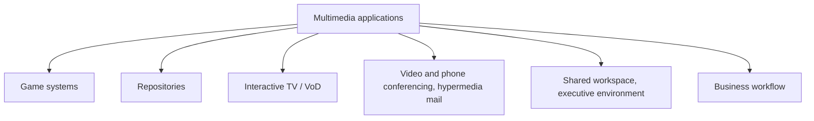

# Application Classes

| Class | Description from the notes |
|---|---|
| **Game systems** | The **leaders in using multimedia technology** because the **market is very large** and demands on quality, although intense, **are not crucial to the success** |
| **Multimedia repositories** | Mostly **play-back-only** systems. **End users do not usually add information**; input and output of the workflow are **independent**. Like games, but the **database is much larger** and the **data needs indexing** |
| **Interactive TV and video on demand** | Usually developed from **cable TV technology**. The **set-top box** connects the **digital network** to the **TV** and other home appliances (telephone, fax). Besides the cable converter function it offers a **full interactive multimedia interface** to services; **standardising the interfaces** (set-top box to network and to home appliance) is **critical** |
| **Video/phone conferencing and hypermedia mail** | **Seeing the other person** is a major improvement over voice only. More functions: **interactive whiteboard**, sharing **paper-based diagrams**, sharing **computer output**. **Video messages are kept longer** than voice messages, so need **much more storage** |
| **Shared workspaces and executive environments** | **Shared workspace:** a user runs applications and the output appears on **screens at remote locations**. **Shared executive environment:** users at different places **run the same application on their own workstation with the same data** |
| **Business process workflow applications** | Depend on the **business process** being served. **Traditional relational databases must be extended** to handle multimedia elements; **object-oriented databases** are a **more natural medium** for multimedia objects |

!!! exam "Exam tip"
    Learn one distinguishing sentence per class: games = big market; repositories = play-back only, indexed; interactive TV = set-top box; conferencing = whiteboard, sharing; shared workspace vs shared executive environment; workflow = object-oriented databases.

## Checkpoint

??? question "Differentiate shared workspace and shared executive environment."
    Shared workspace: one site runs the application, others see its output. Shared executive environment: each site runs the same application locally on the same data.

??? question "What is a set-top box?"
    The device connecting the digital network to the TV and home appliances, providing interactive multimedia services.
